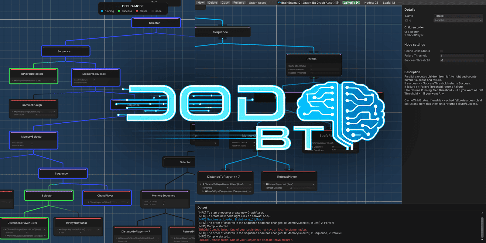
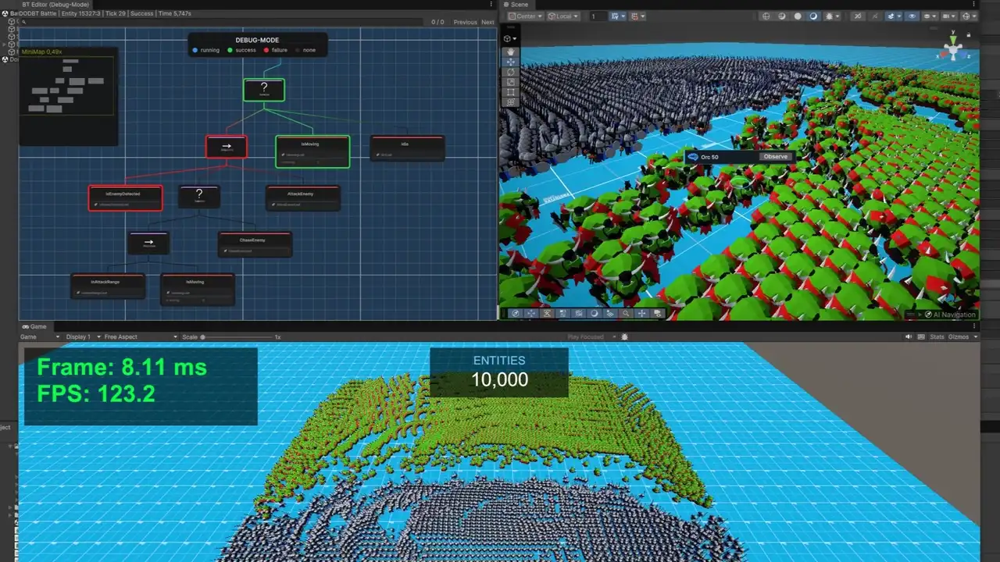
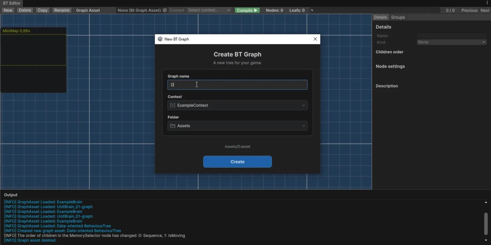
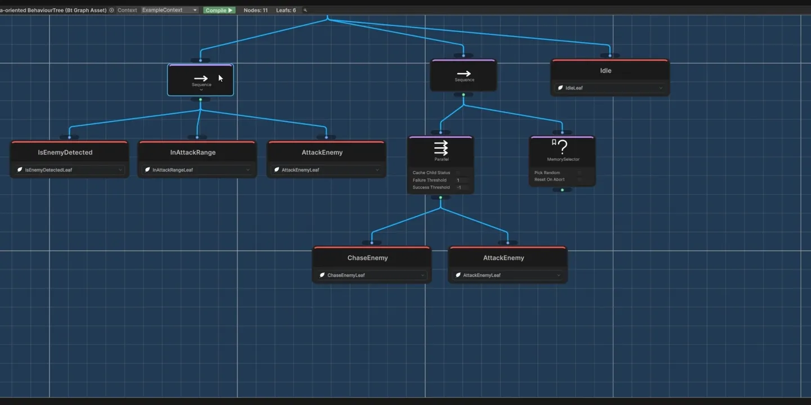
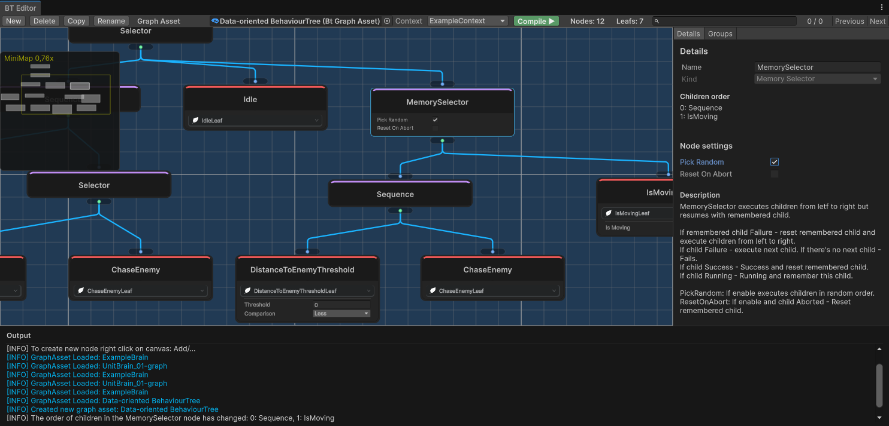
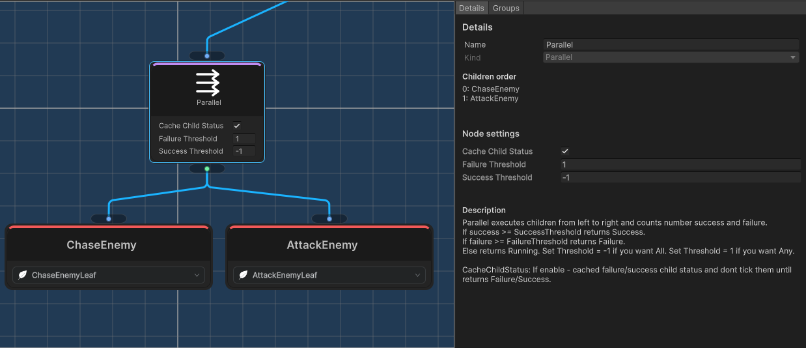

<p align="right">
  🌐 <strong>Русский</strong>
</p>

<p align="center">
  <a href="VadimBurym-DODBT-Light/DOCUMENTATION-ru.md">DODBT-Light</a> &nbsp;·&nbsp;
  <a href="VadimBurym-DODBT-Dots/DOCUMENTATION-ru.md">DODBT-Dots</a> &nbsp;·&nbsp;
  <a href="VadimBurym-DODBT-Light/Samples~/Example2D/README-RU.md">Example2D</a> &nbsp;·&nbsp;
  <a href="VadimBurym-DODBT-Dots/Samples~/BattleExample/README-RU.md">Battle Example</a> &nbsp;·&nbsp;
  <a href="#gallery">Галерея</a> &nbsp;·&nbsp;
  <a href="LICENSE.md">Лицензия</a>
</p>

<h1 align="center">DODBT</h1>

<p align="center"><strong>Деревья поведения на C# для Unity, ECS-архитектур и Unity DOTS — полный цикл работы от визуальной сборки дерева до точечной отладки агента.</strong></p>

<p align="center">
  
  
  
  
</p>

<a id="benefits"></a>

<h2 align="center">⭐ 10 причин выбрать DODBT</h2>

**⭐ 0 MonoBehaviour**<br>
Выполнение дерева не привязано к жизненному циклу Unity.

**⭐ 0 GC-аллокаций**<br>
Предсказуемый обход дерева без GC.

**⭐ Одно общее BT на N агентов**<br>
Архитектура, оптимизированная по памяти.

**⭐ Отладка во время игры**<br>
Разбирайте поведение выбранного агента в Play Mode.

**⭐ Полноценный редактор графов BT**<br>
Логи, подсказки, поиск и наглядная визуализация.

**⭐ Граф и runtime разделены**<br>
Граф компилируется в компактные данные. Редакторские инструменты не нужны в сборке.

**⭐ BT — слой принятия решений**<br>
Дерево выбирает поведение, игровые системы исполняют его. Частоту Tick определяете вы.

**⭐ Без Blackboard**<br>
Зависимости передаются напрямую. В Light доступны DI и ServiceLocator.

**⭐ ECS-friendly**<br>
Light встраивается в обычные C#-системы, Dots — в Unity Entities с Burst и Jobs.

**⭐ Production quality**<br>
Ключевые механизмы покрыты тестами, граф проверяется при компиляции, поведение агентов доступно для визуальной отладки.

<p align="center">
  
</p>

<a id="versions"></a>

<h2 align="center">Какую версию выбрать</h2>

<table width="100%">
<thead>
<tr>
<th width="24%" align="left"></th>
<th width="38%" align="left">DODBT-Light</th>
<th width="38%" align="left">DODBT-Dots</th>
</tr>
</thead>
<tbody>
<tr>
<td>Выполнение</td>
<td>Обычный C#</td>
<td>Unity Entities, Burst и Jobs</td>
</tr>
<tr>
<td>Когда выбирать</td>
<td>Проекты без требования выполнять BT внутри Burst Jobs</td>
<td>Проекты на DOTS с большим числом агентов и обработкой AI в Jobs</td>
</tr>
<tr>
<td>Контекст</td>
<td>Пользовательский класс, включая managed-ссылки и сервисы</td>
<td>Unmanaged-структура с данными и доступом к ECS</td>
</tr>
<tr>
<td>Состояние листа</td>
<td>Пользовательская структура LeafState</td>
<td>Фиксированное состояние; дополнительные данные — в ECS-компонентах</td>
</tr>
<tr>
<td>Интеграция</td>
<td>Проще; допускает DI и отлично подходит для ECS как managed-layer</td>
<td>Требует знания Entities, зависимостей Jobs и жизненного цикла native-данных</td>
</tr>
<tr>
<td>Зависимости ядра</td>
<td>—</td>
<td>Entities, Burst, Collections и Mathematics</td>
</tr>
<tr>
<td>Пример</td>
<td>Example2D на LeoEcsLite и ServiceLocator</td>
<td>Battle Example: бой 10 000 агентов</td>
</tr>
</tbody>
</table>

> [!NOTE]
> DODBT-Light изначально создавался для удобной интеграции в ECS-архитектуру, но не привязан к ней: его можно использовать и в проектах с ООП, и с собственными игровыми системами на C#.

> [!TIP]
> Если вы ищете Behaviour Tree для **LeoEcsLite, LeoEcsProto, Entitas, Morpeh** или похожего ECS-фреймворка и планируете выполнять дерево обычным C#-кодом, выбирайте **DODBT-Light**. Он вписывается в ECS-архитектуру как managed-слой принятия решений: контекст может содержать ссылки на ваши ECS-данные и сервисы, а игровые системы исполняют выбранное поведение.
>
> **DODBT-Dots** специализирован на архитектуре **Unity Entities** с выполнением дерева через **Burst и Jobs** и хранением данных в **unmanaged-памяти**. Здесь другой подход к размещению данных и состоянию агентов, рассчитанный на высокую производительность при массовой обработке AI.

<a id="installation"></a>

<h2 align="center">Установка</h2>

### Через Package Manager и Git

Откройте **Window → Package Management → Package Manager**, выберите **+ → Install package from git URL** и укажите адрес нужного пакета.

- **Light:** `https://github.com/vadimburym/DODBT.git?path=/VadimBurym-DODBT-Light`
- **Dots:** `https://github.com/vadimburym/DODBT.git?path=/VadimBurym-DODBT-Dots`

### Из ZIP без Git

1. Распакуйте ZIP с плагином в постоянную папку на диске.
2. В Package Manager выберите **+ → Install package from disk**.
3. Укажите `package.json` внутри `VadimBurym-DODBT-Light` или `VadimBurym-DODBT-Dots`.

Unity использует эту папку как локальный пакет, поэтому после подключения ее нельзя удалять или перемещать. Сам ZIP не является UPM-пакетом. [Установка локального пакета](https://docs.unity3d.com/6000.0/Documentation/Manual/upm-ui-local.html).

### Из `.unitypackage`

Если в выбранном релизе приложен `.unitypackage`, откройте **Assets → Import Package → Custom Package** и выберите файл. Оставьте целиком папку нужного плагина или обе папки; примеры можно исключить из импорта.

Этот способ помещает файлы в `Assets`. Для Dots предварительно установите зависимости через Package Manager: импорт `.unitypackage` не устанавливает зависимости из `package.json` автоматически. [Импорт пакета ассетов](https://docs.unity3d.com/6000.0/Documentation/Manual/AssetPackagesImport.html).

> [!WARNING]
> Не устанавливайте один и тот же вариант одновременно через UPM и в `Assets`: это создаст дубликаты типов и сборок. Выбирайте папку плагина целиком — частичный импорт Runtime, Editor или DLL генератора не поддерживается. Light и Dots совместимы друг с другом.

<a id="samples"></a>

<h2 align="center">Как установить примеры</h2>

При UPM-установке откройте пакет в **Package Manager → Samples** и нажмите **Import**:

- **DODBT-Light → LeoECS 2D Example** — небольшая 2D-игра с LeoEcsLite и ServiceLocator.
- **DODBT-Dots → Battle Example** — бой с общим blob дерева, отдельными состояниями агентов и Burst Jobs.

Unity копирует выбранный пример в проект:

```text
Assets/Samples/DODBT-Light/<версия пакета>/LeoECS 2D Example/
Assets/Samples/DODBT-Dots/<версия пакета>/Battle Example/
```

Это ваша копия: ее можно изучать и менять. Обновление пакета не обновляет уже импортированный пример. Перед импортом новой версии сохраните правки и оставьте одну копию каждого примера, чтобы не получить дубликаты сборок и типов.

> [!IMPORTANT]
> Сначала установите зависимости примера. Для Battle Example нужны **Entities Graphics 1.5.0, URP 17.3.0, Input System 1.18.0** и настроенный URP-проект. Зависимости Example2D перечислены в его [README](VadimBurym-DODBT-Light/Samples~/Example2D/README-RU.md). Эти пакеты не требуются ядру Light.

При установке через `.unitypackage` вкладка Samples не появляется: примеры выбираются в окне импорта или поставляются отдельными пакетами ассетов. Если пример уже находится в `Assets`, откройте его сцену напрямую. [Как устроены Samples в Unity](https://docs.unity3d.com/6000.0/Documentation/Manual/cus-samples.html).

> [!NOTE]
> Примеры показывают использование плагина и не являются рекомендацией по архитектуре игрового проекта.

<a id="documentation"></a>

<h2 align="center">Документация</h2>

<table width="100%">
<thead>
<tr>
<th width="32%" align="left">Руководство</th>
<th width="68%" align="left">Что внутри</th>
</tr>
</thead>
<tbody>
<tr>
<td><a href="VadimBurym-DODBT-Light/DOCUMENTATION-ru.md">DODBT-Light</a></td>
<td>Контекст и LeafState, листья, редактор, DI, выполнение, отладка и публичный API.</td>
</tr>
<tr>
<td><a href="VadimBurym-DODBT-Dots/DOCUMENTATION-ru.md">DODBT-Dots</a></td>
<td>Контекст, листья, редактор, blob, подготовка агентов, Burst Jobs, отладка и публичный API.</td>
</tr>
<tr>
<td><a href="VadimBurym-DODBT-Light/Samples~/Example2D/README-RU.md">Example2D</a></td>
<td>Запуск 2D-примера Light на LeoEcsLite и подключение к игровым системам.</td>
</tr>
<tr>
<td><a href="VadimBurym-DODBT-Dots/Samples~/BattleExample/README-RU.md">Battle Example</a></td>
<td>Запуск примера Dots, ECS-интеграция и выполнение деревьев в Jobs.</td>
</tr>
</tbody>
</table>

Для первого знакомства импортируйте пример выбранной версии и откройте `ExampleBrain` в BT Editor. Запустите сцену, выберите агента и нажмите **Observe**, чтобы сопоставить решения дерева с поведением в игре.

<a id="gallery"></a>

<h2 align="center">Галерея</h2>

<p align="center">
  <a href="VadimBurym-DODBT-Dots/DOCUMENTATION-ru.md#debugging"></a>
  <a href="VadimBurym-DODBT-Dots/DOCUMENTATION-ru.md#create-graph"></a>
  <a href="VadimBurym-DODBT-Dots/DOCUMENTATION-ru.md#graph-editing"></a>
  <a href="VadimBurym-DODBT-Dots/DOCUMENTATION-ru.md#quality-of-life"></a>
  <a href="VadimBurym-DODBT-Dots/DOCUMENTATION-ru.md#graph-editor"></a>
  <a href="VadimBurym-DODBT-Dots/DOCUMENTATION-ru.md#quality-of-life"></a>
</p>

<a id="tests-and-performance"></a>

<h2 align="center">Тесты и производительность</h2>

**Проверки поведения.** Вместе с пакетами доступны [тесты Light](VadimBurym-DODBT-Light/Tests) и [тесты Dots](VadimBurym-DODBT-Dots/Tests): жизненный цикл, выполнение нод, компиляция, сериализация и редакторские операции.

**Выигрыш Burst + Jobs.** В сравнительном тесте Dots на **10 000 агентах** время обработки уменьшилось с **126 мс до 1 мс** при включении Burst и Jobs. Это один сценарий Dots с ними и без них; устройство данных, позволяющее такое выполнение, связано с ограничениями этой версии. [Подробнее о выигрыше и ограничениях](VadimBurym-DODBT-Dots/DOCUMENTATION-ru.md#performance-gain).

> [!NOTE]
> Это результат конкретного теста, а не сравнение Light с Dots и не гарантия времени кадра. Состав дерева, листья, частота тиков и оборудование влияют на результат. Frame/FPS в примере показывает весь кадр, включая игровые системы и рендеринг.

**Проверка интеграции.** Battle Example запускает 10 000 агентов с интервалом AI 0,2 секунды и распределением тиков между кадрами. Example2D показывает тот же принцип разделения решений дерева и исполнения действий на обычном C#.

<a id="license"></a>

<h2 align="center">Лицензия</h2>

DODBT-Light и DODBT-Dots распространяются по общей [DODBT Custom Game-Use and Redistribution License](LICENSE.md). Полный текст также включен в каждый пакет.

Для кода примеров и сторонних материалов действуют отдельные условия, указанные в их README и LICENSE.
