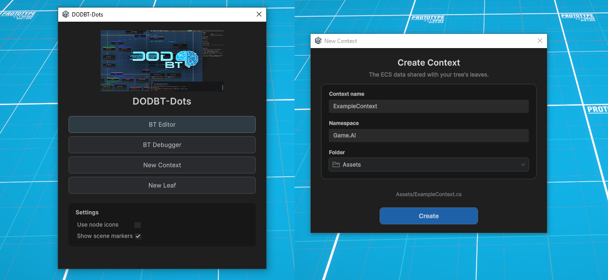
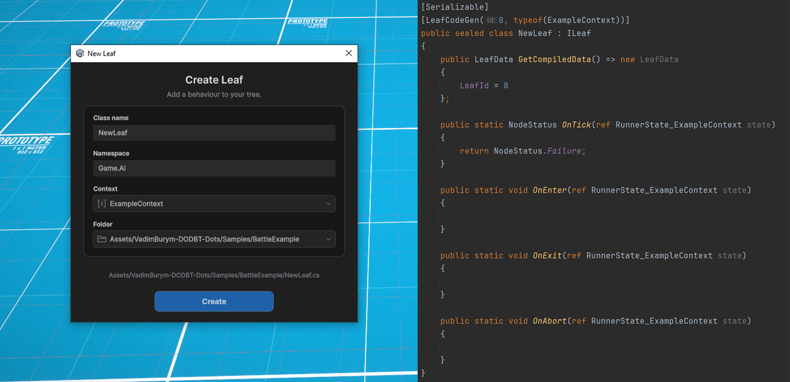

<p align="right">
  🌐 <a href="DOCUMENTATION-ru.md">Русский</a> &nbsp;|&nbsp; <strong>English</strong>
</p>

<p align="center">
  <a href="../README.md#installation">Installation</a> &nbsp;·&nbsp;
  <a href="../VadimBurym-DODBT-Light/DOCUMENTATION-en.md">DODBT-Light</a> &nbsp;·&nbsp;
  <a href="Samples~/BattleExample/README-RU.md">Battle Example</a> &nbsp;·&nbsp;
  <a href="LICENSE.md">License</a>
</p>

<h1 align="center">DODBT-Dots</h1>

<p align="center">Behaviour trees for Unity DOTS.</p>

<p align="center">
  
  
  
  
</p>

> [!IMPORTANT]
> DODBT-Dots is designed for projects with a strict game AI time budget. Using it requires an understanding of Unity Entities, Burst, Jobs, and native memory management, which brings several limitations (see [Limitations](#limitations)). If your project does not need these tools, I recommend [DODBT-Light](../VadimBurym-DODBT-Light/DOCUMENTATION-en.md). Dots is much more complex to integrate, and in a project that does not fit this approach, its limitations may create more work than the execution time they save.

> [!IMPORTANT]
> This guide assumes you already know how Behaviour Trees work. It does not cover the general theory of the algorithm.

> [!IMPORTANT]
> **Tested configuration:** Unity **6000.3.10f1**, Entities **1.5.0**, Burst **1.8.29**, Collections **2.7.1**, Mathematics **1.3.2**.

<h2 align="center">Contents</h2>

- [Context](#context)
  - [Context example from Battle Example](#context-example)
  - [Code generation](#code-generation)
- [Leaves in DOTS](#leaves)
  - [Lifecycle](#leaf-lifecycle)
  - [RunnerState_&lt;YourContext&gt;: data passed to leaves](#runner-state)
  - [LeafData: shared settings for agents](#leaf-data)
  - [LeafState: individual agent state](#leaf-state)
  - [A simple condition leaf from BattleExample](#condition-example)
  - [A more complex action leaf from BattleExample](#action-example)
- [Graph editor](#graph-editor)
  - [Creating a tree asset](#create-graph)
  - [Building a graph](#graph-editing)
  - [Quality of Life](#quality-of-life)
- [Project integration](#integration)
  - [Creating trees at runtime](#create-trees)
  - [Creating agents and initializing buffers](#agent-state-buffers)
  - [Running the tree at runtime](#tree-execution)
- [Debugging](#debugging)
  - [What to connect for debugging](#debug-integration)
  - [Visual debugger](#debugger-window)
  - [Observe above the selected unit](#scene-observe)
- [Limitations and trade-offs](#limitations)
  - [LeafData and leaf settings](#leaf-data-limits)
  - [Context and state](#context-state-limits)
  - [Behaviour and integration](#integration-limits)
  - [Tree size and directives](#size-limits)
  - [Performance gain](#performance-gain)
- [Automated checks](#automated-tests)
- [License](#license)
- [Public API](#public-api)
  - [GenerateBtRunnerAttribute](#api-generate-bt-runner)
  - [LeafCodeGenAttribute](#api-leaf-code-gen)
  - [ILeaf](#api-ileaf)
  - [LeafIconAttribute](#api-leaf-icon)
  - [RunnerState_&lt;Context&gt;](#api-runner-state)
  - [LeafData](#api-leaf-data)
  - [LeafStateElement](#api-leaf-state-element)
  - [NodeStatus](#api-node-status)
  - [BehaviourTreeAsset](#api-behaviour-tree-asset)
  - [BehaviourTreeBlob](#api-behaviour-tree-blob)
  - [NodeStateElement](#api-node-state-element)
  - [BTRunner_&lt;Context&gt;](#api-bt-runner)
  - [BtDebugTree](#api-bt-debug-tree)
  - [BtDebugTarget](#api-bt-debug-target)
  - [BtDebugNodeState](#api-bt-debug-node-state)
  - [BtDebugSnapshot](#api-bt-debug-snapshot)

<a id="getting-started"></a>

<a id="context"></a>

<h2 align="center">Context</h2>

Open **Tools → VadimBurym → DODBT-Dots** and click **New Context**.

<p align="center">
  <a href="docs~/images/01-create-context.webp"></a>
</p>

**The context is a typed set of data and access handles that the tick system passes to leaves.** It defines what the tree can read about the game and which commands it can send.

The context can contain:

- `ComponentLookup<T>` and `BufferLookup<T>` for accessing ECS data;
- `EntityStorageInfoLookup` for checking whether entities exist;
- `EntityCommandBuffer.ParallelWriter` for recording commands from a parallel Job;
- numbers, IDs, time, and other unmanaged values;
- Job-compatible native containers and blob references with correctly configured access and lifetimes.

> [!IMPORTANT]
> It cannot contain `GameObject`, `MonoBehaviour`, a regular C# service, `string`, `List<T>`, or another managed reference. Passing native containers does not automatically make concurrent writes safe either: Job rules still apply.

<a id="context-example"></a>

### Context example from Battle Example:

```csharp
[GenerateBtRunner]
public struct ExampleContext
{
    public EntityCommandBuffer.ParallelWriter Ecb;
    public EntityStorageInfoLookup EntityInfoLookup;

    [ReadOnly] public ComponentLookup<EyeSensor> EyeSensorLookup;
    [ReadOnly] public ComponentLookup<LocalTransform> LocalTransformLookup;
    [ReadOnly] public ComponentLookup<AttackStats> AttackStatsLookup;
    [ReadOnly] public ComponentLookup<GridNavigationState> GridNavigationStateLookup;
    [ReadOnly] public ComponentLookup<IsMovingTag> IsMovingTagLookup;
    [ReadOnly] public ComponentLookup<RendererEntityRef> RenderEntityLookup;
    [ReadOnly] public ComponentLookup<AttackState> AttackStateLookup;
}
```

<a id="code-generation"></a>

### Code generation

After C# compilation, you will need two generated files for the context you created (called `<YourContext>` below):

<table width="100%">
<thead>
<tr>
<th width="25%" align="left">File</th>
<th width="75%" align="left">Purpose</th>
</tr>
</thead>
<tbody>
<tr>
<td><code>BTRunner_&lt;YourContext&gt;.g.cs</code></td>
<td>Tree traversal: Tick, Abort, and the editor-only TickWithDebug.</td>
</tr>
<tr>
<td><code>RunnerState_&lt;YourContext&gt;.g.cs</code></td>
<td>Data passed to the leaf being executed.</td>
</tr>
</tbody>
</table>

> [!NOTE]
> The types are in `VadimBurym.DodBehaviourTree.Dots.Generated` and compile into your context's assembly. They are generated automatically by Roslyn, not files you need to create or edit in `Assets`.

<a id="leaves"></a>

<h2 align="center">Leaves in DOTS</h2>

Open **Tools → VadimBurym → DODBT-Dots** and click **New Leaf**. A leaf is created for **one specific context**.

<p align="center">
  <a href="docs~/images/02-create-leaf.webp"></a>
</p>

**A leaf connects tree decisions to game systems.** A condition reads a prepared sensor value, an action starts an operation, Running waits for the result, and Exit/Abort end it. Movement, navigation, attacks, and animation stay in systems you write. Short calculations can run directly in a leaf; this separation is especially useful for ongoing behaviour and different AI and game update rates.

> [!NOTE]
> The leaf class and interface are used for editor configuration. Its fields are serialized in the graph, and `GetCompiledData()` packs the required values into `LeafData`. During Burst execution, no instances of this class are created: the runner calls its static methods efficiently and safely.

<a id="leaf-lifecycle"></a>

### Lifecycle

<table width="100%">
<thead>
<tr>
<th width="25%" align="left">Method</th>
<th width="75%" align="left">When it is called</th>
</tr>
</thead>
<tbody>
<tr>
<td><code>OnEnter</code></td>
<td>Before the first Tick of an inactive leaf. A suitable place to start an action.</td>
</tr>
<tr>
<td><code>OnTick</code></td>
<td>Returns <code>Running</code>, <code>Success</code>, or <code>Failure</code>. <code>None</code> is not a result for a gameplay leaf.</td>
</tr>
<tr>
<td><code>OnExit</code></td>
<td>After <code>OnTick</code> returns Success or Failure.</td>
</tr>
<tr>
<td><code>OnAbort</code></td>
<td>When an active leaf is aborted, for example after switching branches.</td>
</tr>
</tbody>
</table>

> [!IMPORTANT]
> `OnEnter` and the first `OnTick` happen in the same runner call. While the result is Running, the next Tick does not call OnEnter again. After completion, entering the leaf again calls OnEnter again.

> [!WARNING]
> When switching branches, the new Enter/Tick calls happen **before Abort on the previous Running branch**. Do not make actions mutually exclusive by assuming the old action always ends first. For separate action entities, an explicit owner and independent cleanup for each operation are useful.

<a id="runner-state"></a>

### `RunnerState_<YourContext>`: data passed to leaves

Each leaf method takes `ref RunnerState_<YourContext> state` — you use it throughout the leaf lifecycle to implement your behaviour.

<table width="100%">
<thead>
<tr>
<th width="25%" align="left">Field</th>
<th width="75%" align="left">Contents</th>
</tr>
</thead>
<tbody>
<tr>
<td><code>Agent</code></td>
<td>Entity: the specific agent whose tree is running.</td>
</tr>
<tr>
<td><code>Context</code></td>
<td><code>&lt;YourContext&gt;</code>: the shared context you created earlier.</td>
</tr>
<tr>
<td><code>LeafData</code></td>
<td>Compiled, shared, immutable leaf settings.</td>
</tr>
<tr>
<td><code>LeafState</code></td>
<td>Mutable leaf state for a specific agent.</td>
</tr>
<tr>
<td><code>Random</code></td>
<td>The agent's <code>Unity.Mathematics.Random</code> state. The runner returns changes to the caller.</td>
</tr>
<tr>
<td><code>SortKey</code></td>
<td>The ECB command sort key; for example, the chunk index.</td>
</tr>
</tbody>
</table>

<a id="leaf-data"></a>

### LeafData: shared settings for agents

Each leaf has settings shared by all agents, stored in LeafData. The leaf's internal ID is included automatically and should not be changed. All fields are described in the [LeafData reference](#api-leaf-data). Its structure is fixed:

```csharp
public struct LeafData
{
    public int LeafId;
    public int Int0;
    public float Float0;
    public byte Byte0;
    public FixedList32Bytes<byte> Bytes;
}
```

You can also make leaf values configurable in the editor. Add a serializable field directly to the class, such as `[SerializeField] private float _distance;`. Write it to `Float0` inside `GetCompiledData()`, then read it through `state.LeafData.Float0`. You decide what each slot means for a specific leaf. The fixed structure and access to LeafData are among the main limitations of Dots.

<a id="leaf-state"></a>

### LeafState: individual agent state

[`LeafStateElement`](#api-leaf-state-element) has fixed fields:

<table width="100%">
<thead>
<tr>
<th width="25%" align="left">Field</th>
<th width="75%" align="left">Purpose</th>
</tr>
</thead>
<tbody>
<tr>
<td><code>IsEntered</code></td>
<td>Indicates an active entry; managed by the runner.</td>
</tr>
<tr>
<td><code>BufferIndex</code></td>
<td>The index of this node's state in the agent buffer; set during initialization.</td>
</tr>
<tr>
<td><code>StateEntity</code></td>
<td>A reference to an entity holding extra action state. You create and manage it when implementing complex behaviour.</td>
</tr>
</tbody>
</table>

> [!NOTE]
> Each agent has its own state buffer. Two occurrences of the same leaf class in a graph receive separate states.

**StateEntity connects the behaviour tree to game mechanics.** In this design, the tree starts and stops behaviour, while a separate system handles its execution.

When starting behaviour, the leaf should create an action entity with a component holding a reference to the agent and the required parameters. For example, a leaf creates AttackState, which stores the attacking agent and its target. Your game system finds entities with AttackState and processes them independently of tree ticks: it tracks time, performs attacks, or controls movement. The component's presence makes the action available for processing; removing the component or the entire entity stops it. A reference to the entity with AttackState is stored in StateEntity so the leaf can manage or remove it when the action is aborted.

A simple version of the cycle is:

1. The leaf creates an action for the agent.
2. The leaf stores a reference to this action in `StateEntity`.
3. A separate system processes the action.
4. The leaf watches the action and removes it when needed.

> [!IMPORTANT]
> In Dots, you do not declare an arbitrary generic LeafState type as you do in Light. Timers, targets, and results of long-running actions can be stored in agent components or in a separate entity referenced by `StateEntity`. A condition leaf usually does not need a separate entity.

> [!WARNING]
> When creating an action entity, you need to store it in StateEntity. If you create the action through an ECB, you cannot write the returned Entity directly to LeafState.StateEntity. You also need to write to LeafState through the ECB. BattleExample shows this with [LeafStateWriteRequest](Samples~/BattleExample/BehaviourTree/Integration/LeafStateWriteRequest.cs) and [LeafStateWriteSystem](Samples~/BattleExample/BehaviourTree/Integration/LeafStateWriteSystem.cs). Also keep in mind that the action entity may not exist yet during the first `OnTick`, so check that it exists before accessing it in OnTick.

<a id="condition-example"></a>

### A simple condition leaf from BattleExample

```csharp
[Serializable]
[LeafCodeGen(1, typeof(ExampleContext))]
public sealed class IsEnemyDetectedLeaf : ILeaf
{
    public LeafData GetCompiledData() => new LeafData
    {
        LeafId = 1
    };

    public static NodeStatus OnTick(ref RunnerState_ExampleContext state)
    {
        var sensor = state.Context.EyeSensorLookup[state.Agent];
        bool exists = state.Context.EntityInfoLookup.Exists(sensor.DetectedEntity);
        return sensor.IsDetected == 1 && exists ? NodeStatus.Success : NodeStatus.Failure;
    }

    public static void OnEnter(ref RunnerState_ExampleContext state) { }
    public static void OnExit(ref RunnerState_ExampleContext state) { }
    public static void OnAbort(ref RunnerState_ExampleContext state) { }
}
```

Full source: [IsEnemyDetectedLeaf](Samples~/BattleExample/BehaviourTree/Leaves/IsEnemyDetectedLeaf.cs).

A separate game system updates the sensor. The leaf only reads the result. This assumes every agent has `EyeSensor`; for an optional component, check `HasComponent` first.

<a id="action-example"></a>

### A more complex action leaf from BattleExample

A shortened example from [AttackEnemyLeaf](Samples~/BattleExample/BehaviourTree/Leaves/AttackEnemyLeaf.cs). Attack execution is handled by [AttackStateSystem](Samples~/BattleExample/BehaviourTree/Systems/AttackStateSystem.cs).

```csharp
[Serializable]
[LeafCodeGen(6, typeof(DODBT.Example.BehaviourTree.ExampleContext))]
public sealed class AttackEnemyLeaf : ILeaf
{
    public LeafData GetCompiledData() => new LeafData
    {
        LeafId = 6
    };

    public static NodeStatus OnTick(ref RunnerState_ExampleContext state)
    {
        var lookUp = state.Context.AttackStateLookup;
        if (!lookUp.HasComponent(state.LeafState.StateEntity))
            return NodeStatus.Running;
        if (!state.Context.EntityInfoLookup.Exists(lookUp[state.LeafState.StateEntity].Target))
            return NodeStatus.Failure;
        if (state.Context.EyeSensorLookup[state.Agent].DetectedEntity != lookUp[state.LeafState.StateEntity].Target)
            return NodeStatus.Failure;

        return NodeStatus.Running;
    }

    public static void OnEnter(ref RunnerState_ExampleContext state)
    {
        var ecb = state.Context.Ecb;
        var entity = ecb.CreateEntity(state.SortKey);
        ecb.AddComponent(state.SortKey, entity, new AttackState {
            Owner = state.Agent,
            Target = state.Context.EyeSensorLookup[state.Agent].DetectedEntity
        });
        ecb.AddComponent(state.SortKey, ecb.CreateEntity(state.SortKey), new LeafStateWriteRequest {
            Entity = state.Agent,
            Index = state.LeafState.BufferIndex,
            Value = entity
        });
        ecb.SetComponentEnabled<SeeToDetectedTag>(state.SortKey, state.Agent, true);
    }

    public static void OnExit(ref RunnerState_ExampleContext state)
    {
        var ecb = state.Context.Ecb;
        ecb.DestroyEntity(state.SortKey, state.LeafState.StateEntity);
        ecb.SetComponentEnabled<SeeToDetectedTag>(state.SortKey, state.Agent, false);
    }

    public static void OnAbort(ref RunnerState_ExampleContext state)
    {
        var ecb = state.Context.Ecb;
        ecb.DestroyEntity(state.SortKey, state.LeafState.StateEntity);
        ecb.SetComponentEnabled<SeeToDetectedTag>(state.SortKey, state.Agent, false);
    }
}
```

<a id="graph-editor"></a>

<h2 align="center">Graph editor</h2>

Open **Tools → VadimBurym → DODBT-Dots** and click **BT Editor**.

<p align="center">
  <a href="docs~/images/03-editor-overview.webp"></a>
</p>

<a id="create-graph"></a>

### Creating a tree asset

Create a new behaviour tree asset by clicking `New` in the editor toolbar. The editor creates two assets: one for editing and a _Compiled version for execution.

<p align="center">
  <a href="docs~/images/08-create-graph.webp"></a>
</p>

<p align="center"><em>Creating a graph, adding nodes, and configuring leaves.</em></p>

A tree is created for **one specific context**. The leaves available in the tree are limited by the selected context. You can change the context later in the editor's top toolbar. Existing leaves keep their settings; incompatible nodes show a `Context mismatch` warning until replaced with compatible leaves.

**Copy** creates a separate tree with its own compiled asset. **Rename** in BT Editor renames the pair. **Delete** removes the selected graph and its compiled asset after confirmation.

<a id="graph-editing"></a>

### Building a graph

Right-click an empty area and select **Add → node type**.

Connect the parent's output to the child's input. Root must have one output; all other nodes must have one parent. Child order follows their positions **from left to right**. Moving nodes horizontally changes execution priority.

For leaves, select one of the implementations you created earlier.

<p align="center">
  <a href="docs~/images/07-select-leaf.webp"></a>
</p>

<p align="center"><em>Selecting a leaf implementation directly in the node.</em></p>

> [!TIP]
> Nodes that are not connected to Root can be kept as drafts — they are not included in the compiled tree.

<a id="node-types"></a>

#### Available nodes

<table width="100%">
<thead>
<tr>
<th width="25%" align="left">Node</th>
<th width="75%" align="left">Behaviour</th>
</tr>
</thead>
<tbody>
<tr>
<td>Root</td>
<td>Points to the entry point of the graph</td>
</tr>
<tr>
<td>Leaf</td>
<td>A user-defined condition or action.</td>
</tr>
<tr>
<td>Sequence</td>
<td>Checks children from left to right; stops on Failure or Running. Each new Tick starts checking from the beginning.</td>
</tr>
<tr>
<td>Selector</td>
<td>Finds the first child that returns Success or Running. Each new Tick starts again with the higher-priority children on the left.</td>
</tr>
<tr>
<td>MemorySequence</td>
<td>Continues from the saved child. <code>Reset On Failure</code> controls reset on Failure, and <code>Reset On Abort</code> controls reset on abort. Starts over after an overall Success.</td>
</tr>
<tr>
<td>MemorySelector</td>
<td>Remembers the Running child. <code>Pick Random</code> chooses a random starting position; after Failure, it cycles through children without visiting any twice in one attempt. <code>Reset On Abort</code> controls reset on abort.</td>
</tr>
<tr>
<td>Parallel</td>
<td>Visits several branches per Tick and counts their results against Success and Failure thresholds. <code>Cache Child Status</code> avoids calling children that have already finished during the current attempt.</td>
</tr>
</tbody>
</table>

> [!IMPORTANT]
> **Parallel does not create threads or Jobs.** It defines tree behaviour; the runner visits branches sequentially within one agent. Your Job provides parallel execution across agents.

> [!IMPORTANT]
> **Dots currently has no decorators.** The data format, compiler, and generated runner do not implement them. This is a limit of the current version, not of Burst itself. Conditions can be expressed as a leaf before an action in a Sequence; delays and cooldowns can be handled by action state or a game system.

<a id="quality-of-life"></a>

### Quality of Life

The plugin keeps growing with new improvements to ease of use. These changes affect only **authoring — creating, configuring, and editing trees** — and do not affect runtime execution. If something is missing or a step could be simpler, share your ideas and feedback. Your suggestions help decide what comes in future updates.

The editor has a **Details** panel where you can always do the following for the selected node:

- change its name
- check child execution order
- change settings
- read a hint about its behaviour

<p align="center">
  <a href="docs~/images/05-parallel-details.webp"></a>
</p>

**Linked groups** let you repeat a branch within a graph and sync its structure and settings across instances:

1. Select **Create Linked Group** on the root of the branch you need.
2. Use **Duplicate Group** to create a linked copy.
3. The **Groups** tab lists the whole group family and its instances.
4. **Unlink Group** turns the selected instance into an independent branch.

<p align="center">
  <a href="docs~/images/06-linked-groups.webp"></a>
</p>

<p align="center"><em>Linked groups: branch changes are synced across its instances.</em></p>

> [!IMPORTANT]
> Groups must not overlap or contain other linked groups. During compilation, each instance becomes regular nodes with their own state. This is an editor link, not a shared mutable runtime object or a separate subtree shared between agents.

The **Output** panel shows load and compilation results, warnings, and errors. The most common reasons for a failed Compile are:

<table width="100%">
<thead>
<tr>
<th width="40%" align="left">Cause</th>
<th width="60%" align="left">What to fix</th>
</tr>
</thead>
<tbody>
<tr>
<td>Root is not connected to a branch</td>
<td>Connect the entry point to the tree.</td>
</tr>
<tr>
<td>No class is assigned to a Leaf, or its script was deleted</td>
<td>Select an implementation or restore the type and its serialized data.</td>
</tr>
<tr>
<td>The context is not selected, is missing, or does not match the leaf</td>
<td>Restore the context or replace incompatible leaves.</td>
</tr>
<tr>
<td>A cycle, multiple parents, or a reference to a missing node</td>
<td>Fix the connections.</td>
</tr>
<tr>
<td>A composite node without children, or invalid Parallel thresholds</td>
<td>Add children or fix the settings.</td>
</tr>
<tr>
<td>LeafId differs from the attribute</td>
<td>Use the same ID in the declaration and GetCompiledData.</td>
</tr>
</tbody>
</table>

The top toolbar has **New / Delete / Copy / Rename**, graph selection, **Context**, **Compile**, node and leaf counts, search, and **Previous / Next** navigation in one row. Search helps you find a node but does not change its execution order. Undo/Redo are available for supported graph editing operations.

<p align="center">
  <a href="docs~/images/04-editor-toolbar.webp"></a>
</p>

<a id="integration"></a>

<h2 align="center">Project integration</h2>

After creating a graph in the editor, click `Compile` to get a compiled graph asset for execution.

<a id="create-trees"></a>

### Creating trees at runtime

The project uses three different representations:

<table width="100%">
<thead>
<tr>
<th width="40%" align="left">Representation</th>
<th width="60%" align="left">Purpose</th>
</tr>
</thead>
<tbody>
<tr>
<td><code>BtGraphAsset</code></td>
<td>Editor graph: nodes, connections, positions, parameters, and groups.</td>
</tr>
<tr>
<td><code>BehaviourTreeAsset</code></td>
<td>The result of Compile: data needed to create a runtime tree. Assign it to spawn settings or other runtime configurations.</td>
</tr>
<tr>
<td><code>BlobAssetReference&lt;BehaviourTreeBlob&gt;</code></td>
<td>Immutable native data read by a Burst Job. Created from the compiled asset once before the game starts.</td>
</tr>
</tbody>
</table>

For each unique compiled tree asset, create its `Blob` representation using [CreateBlob()](#api-create-blob) on `BehaviourTreeAsset` and store the blobs in ECS for shared access.

> [!TIP]
> **Create one blob per unique compiled tree and share it among all matching agents.** Do not call `CreateBlob()` on every Tick or separately for each identical unit.

**Example from BattleExample:**

In the sample, all tree blobs are stored in one Singleton component that can be accessed at runtime:

```csharp
public struct BehaviourTreeSingleton : IComponentData
{
    public NativeArray<BlobAssetReference<BehaviourTreeBlob>> Blobs;
}
```

For one tree, initialization on the main thread looks like this:

```csharp
// compiled is the BehaviourTreeAsset after a successful Compile.
// manager is your World's EntityManager.

var blob = compiled.CreateBlob();
var trees = new NativeArray<BlobAssetReference<BehaviourTreeBlob>>(1, Allocator.Persistent);
trees[0] = blob;

var singleton = manager.CreateEntity();
manager.AddComponentData(singleton, new BehaviourTreeSingleton
{
    Blobs = trees
});
```

See [BattleSession](Samples~/BattleExample/Setup/BattleSession.cs) for an example owner.

<a id="agent-state-buffers"></a>

### Creating agents and initializing buffers

Along with game components, an agent needs two mutable buffers:

- `NodeStateElement` — traversal and composite node state;
- `LeafStateElement` — state for each occurrence of a Leaf in the tree.

Create these two buffers on the agent and leave them **empty**. Then use [`FillAgentStateBuffers()`](#api-fill-agent-state-buffers) on the compiled `BehaviourTreeAsset` to set their initial internal values.

> [!WARNING]
> The method does not clear a previously filled buffer or create the buffers for you.

**Agent creation example from BattleExample:**

```csharp
using var commands = new EntityCommandBuffer(Allocator.Temp);

var agent = commands.CreateEntity();
commands.AddBuffer<NodeStateElement>(agent);
commands.AddBuffer<LeafStateElement>(agent);
compiled.FillAgentStateBuffers(agent, commands); // compiled is the compiled BehaviourTreeAsset

commands.AddComponent(agent, new AiBrain
{
    BlobId = 0,
    UpdateTime = 0,
    RandomState = 12345u
});

// Also add the components read by leaves using your context here.
commands.Playback(manager);
```

> [!TIP]
> `AiBrain` also belongs to the sample: it stores the tree index, next Tick time, and Random state. In a real spawn setup, give each agent its own nonzero seed and spread the first update times over the interval. Otherwise, identical agents may make identical random decisions and create a load spike at the same time.

> [!NOTE]
> This "warmup" initializes state and allocates memory **before the first Tick**; it is not Burst compilation. The buffers use `InternalBufferCapacity(0)`, so their contents do not reserve a large fixed amount of space inside the chunk. Initial setup has a cost and should not be repeated in the hot loop.

> [!WARNING]
> When using a pool, do not append elements to the old state. If the agent was active, abort its actions properly first; then prepare clean buffers and fill them for the required tree. Simply clearing buffers does not call `OnAbort` or remove your action entities. Do not allow Tick before the playback that prepares the agent has finished.

<a id="tree-execution"></a>

### Running the tree at runtime

Your code sets the execution rate. In Battle Example, each agent's tree updates once every **0.2 seconds**, with agent timers offset from each other. Movement and animation systems can update more often.

The tick system does the following:

1. Gets the shared blob table.
2. Updates lookups and type handles.
3. Creates an ECB through the chosen ECB system and fills `ExampleContext`.
4. Schedules a Burst Job with the incoming `state.Dependency` and stores the returned handle back in it.
5. The Job selects the agent's tree, restores Random, calls the runner, and saves Random and the next update time.

The main part of the Job from BattleExample (see [BehaviourTreeTickSystem](Samples~/BattleExample/BehaviourTree/Integration/BehaviourTreeTickSystem.cs)):

```csharp
var aiBrain = aiBrains[i];
if (aiBrain.UpdateTime > CurrentTime)
    continue;

var entity = entities[i];
var nodeStates = nodeBuffers[i];
var leafStates = leafBuffers[i];
var treeBlob = Trees[aiBrain.BlobId];
var random = new Unity.Mathematics.Random { state = aiBrain.RandomState };

Runner.Tick(
    entity,
    ref treeBlob.Value,
    ref random,
    nodeStates,
    leafStates,
    Context,
    unfilteredChunkIndex);

aiBrain.RandomState = random.state;
aiBrain.UpdateTime += UpdateInterval;
aiBrains[i] = aiBrain;
```

Here, `Runner` is an automatically generated script of type `BTRunner_<YourContext>`. Create it in your system's OnCreate method and cache it for later use. In the sample, this is `_runner = new BTRunner_ExampleContext()`.

For an explicit abort, use [`Runner.Abort`](#api-runner-abort) with `ref random`, the same buffers, and a suitable context. Save the resulting Random back to the agent. Your project handles applying abort commands, removing action entities, and clearing game states.

> [!WARNING]
> `state.Dependency = job.ScheduleParallel(query, state.Dependency)` preserves dependencies on other systems. Do not call `Complete()` after every schedule unless needed. If you create an ECB manually or use custom scheduling, make sure its producers finish before playback and disposal.

> [!IMPORTANT]
> Editing the graph and using Compile does not update an existing blob. In the normal workflow, stop Play Mode, compile the graph, and run the scene again. Replacing a tree at runtime requires stopping its Jobs, aborting old actions, updating the blob reference, and reinitializing buffers. The plugin does not perform automatic hot swapping.

<a id="debugging"></a>

<h2 align="center">Debugging</h2>

<p align="center">
  <a href="docs~/images/03-battle-observe.webp"></a>
</p>

<p align="center"><em>Observe in Battle Example: the selected agent's behaviour and active tree branches in real time.</em></p>

> [!IMPORTANT]
> Tree debugging works **in the Unity Editor during Play Mode**. Editor code and tracing components are excluded from the player through `UNITY_EDITOR`. This is not a remote debugger for a built player.

<a id="debug-integration"></a>

### What to connect for debugging

In the editor, `FillAgentStateBuffers()` automatically adds `BtDebugTree` to the agent: the source graph GUID and compilation revision. This lets the debugger find the agent's tree. You do not need to attach anything manually to every entity through the Inspector.

> [!IMPORTANT]
> For full Observe highlighting, your tick system must support recording statuses for **one selected agent**. The plugin cannot automatically replace an arbitrary user Job and determine its dependencies. Battle Example already includes this integration.

<table width="100%">
<thead>
<tr>
<th width="25%" align="left">Type</th>
<th width="75%" align="left">Who creates and uses it</th>
</tr>
</thead>
<tbody>
<tr>
<td><code>BtDebugTree</code></td>
<td>Added by FillAgentStateBuffers in the Editor. Links the agent to the graph and revision.</td>
</tr>
<tr>
<td><code>BtDebugTarget</code></td>
<td>The Observe window creates a singleton request in the chosen World. The tick system reads the selected entity.</td>
</tr>
<tr>
<td><code>BtDebugNodeState</code></td>
<td>Observe creates a status buffer on the selected agent. The Job writes the TickWithDebug result.</td>
</tr>
<tr>
<td><code>BtDebugSnapshot</code></td>
<td>Observe creates a snapshot component; the Job updates Tick, Time, and the final Status.</td>
</tr>
</tbody>
</table>

> [!IMPORTANT]
> Wrap all references to these four types in your runtime assembly in `#if UNITY_EDITOR`, including fields, initialization, and calls.

**System fields and lookup creation in OnCreate:**

```csharp
#if UNITY_EDITOR
private BufferLookup<BtDebugNodeState> _debugStates;
private ComponentLookup<BtDebugSnapshot> _debugSnapshots;
#endif

// Inside OnCreate:
#if UNITY_EDITOR
_debugStates = state.GetBufferLookup<BtDebugNodeState>();
_debugSnapshots = state.GetComponentLookup<BtDebugSnapshot>();
#endif
```

**Before ScheduleParallel:**

```csharp
#if UNITY_EDITOR
_debugStates.Update(ref state);
_debugSnapshots.Update(ref state);

job.DebugEntity = SystemAPI.TryGetSingleton<BtDebugTarget>(out var target)
    ? target.Entity
    : Entity.Null;
job.DebugStates = _debugStates;
job.DebugSnapshots = _debugSnapshots;
#endif

state.Dependency = job.ScheduleParallel(_query, state.Dependency);
```

**Job fields:**

```csharp
#if UNITY_EDITOR
public Entity DebugEntity;
[NativeDisableParallelForRestriction]
public BufferLookup<BtDebugNodeState> DebugStates;
[NativeDisableParallelForRestriction]
public ComponentLookup<BtDebugSnapshot> DebugSnapshots;
#endif
```

> [!WARNING]
> The parallel access restriction is disabled only for these lookups: the Job writes only to the currently selected agent, and each agent appears once in the query. This attribute does not provide general protection from race conditions; do not copy it without checking your own write pattern.

**Instead of the single Tick call in the agent loop:**

```csharp
bool captured = false;
#if UNITY_EDITOR
if (entity == DebugEntity && DebugStates.HasBuffer(entity) &&
    DebugSnapshots.HasComponent(entity))
{
    var statuses = DebugStates[entity];
    if (statuses.Length == nodeStates.Length)
    {
        var result = Runner.TickWithDebug(
            entity, ref treeBlob.Value, ref random,
            nodeStates, leafStates, Context, unfilteredChunkIndex, statuses);

        var snapshot = DebugSnapshots[entity];
        snapshot.Tick++;
        snapshot.Time = CurrentTime;
        snapshot.Status = result;
        DebugSnapshots[entity] = snapshot;
        captured = true;
    }
}
#endif

if (!captured)
{
    Runner.Tick(entity, ref treeBlob.Value, ref random,
        nodeStates, leafStates, Context, unfilteredChunkIndex);
}
```

> [!WARNING]
> The agent must run **exactly once**: either through regular Tick or TickWithDebug. After this branch, save Random and the timer just as you do without debugging. Do not run an extra Tick for a snapshot or increase the observed agent's update rate. Burst also works for the debug Job; recording adds cost only to the selected agent. The full integration is in the [sample tick system](Samples~/BattleExample/BehaviourTree/Integration/BehaviourTreeTickSystem.cs).

<a id="debugger-window"></a>

### Visual debugger

Open **Tools → VadimBurym → DODBT-Dots**, click **BT Debugger**, select the World you need, and find an agent. The window shows agents linked to a BT and their active leaves, with search and pages. Click **Observe** to open the selected entity's tree.

The active leaf list updates up to twice per second; the full Observe view updates up to 10 times per second. If the tree itself ticks once every 0.2 seconds, new results arrive at its Tick rate. This is expected behaviour, not lost debug frames.

Statuses: blue — Running, green — Success, red — Failure, gray — no result. The header shows the World, entity, Tick number, time, and final status. One active Observe request is allowed per World. Closing observation removes its temporary components.

<a id="scene-observe"></a>

### Observe above the selected unit

In **Tools → VadimBurym → DODBT-Dots**, enable **Settings → Show scene markers** and select an entity in Scene View. An agent with a BT gets a marker with an **Observe** button. Its position comes from `LocalToWorld`; when a child render entity is selected, the plugin follows the `Parent` chain to find the BT owner.

This is part of the plugin: you do not need a special marker MonoBehaviour in your project. The built-in adapter reads entity selection from the Entities editor. It depends on API compatibility with that package version; if incompatible, the scene selection shortcut may be disabled, but the **BT Debugger** list remains available.

If highlighting does not appear, check that:

- the correct World is selected, the entity exists, and both buffers are filled;
- the agent was set up through FillAgentStateBuffers and has BtDebugTree;
- the tick system reads BtDebugTarget, calls TickWithDebug, and updates BtDebugSnapshot;
- no second regular Tick runs after the debug branch;
- the graph is compiled, and the agent uses the same compiled asset and revision;
- the source graph is available in the project.

> [!NOTE]
> If you edit the graph, recompile it, or link the agent to another tree during Observe, observation stops instead of showing mismatched data. Compile the graph, recreate the runtime session, and open Observe again.

<a id="limitations"></a>

<h2 align="center">Limitations and trade-offs</h2>

<a id="leaf-data-limits"></a>

### LeafData and leaf settings

Only the result of `GetCompiledData()` reaches runtime. You must write any field added to the leaf class into the fixed [LeafData](#api-leaf-data) slots yourself: `Int0`, `Float0`, `Byte0`, or `Bytes`.

Unity object references, strings, and regular C# collections do not fit there. Pass numeric parameters and indices, or store extra data in ECS components and blobs accessible through the context.

<a id="context-state-limits"></a>

### Context and state

The context must be `unmanaged`: no `GameObject`, C# services, or other managed references. You cannot get such services through DI or ServiceLocator inside a Burst leaf. Prepare dependencies in your system and pass data, lookups, and an ECB to the leaves.

Leaves and their context must be in the same assembly. Context names within it must be distinct, and leaf implementation IDs must be unique within each context.

[LeafStateElement](#api-leaf-state-element) has a fixed structure. Store timers, targets, and other action data in game components; `StateEntity` links a leaf to a separate action entity. When using an ECB, account for playback. When changing trees, prepare the buffers again and cancel outdated write requests.

<a id="integration-limits"></a>

### Behaviour and integration

Dots has no built-in decorators. Conditions can be expressed as separate leaves, and timers and cooldowns as action state. The `DODBT_DECORATORS` directive applies only to Light.

The tree chooses behaviour; your project implements movement, attacks, sensors, tick rate, and Job scheduling. You are also responsible for ending actions, Job dependencies, and freeing native memory. Battle Example shows one way to integrate it.

<a id="size-limits"></a>

### Tree size and directives

- Up to **65,535 executable nodes** in the regular format, or **255** with `DODBT_SMALL_SIZE`. The editor Root is not included in this count.
- From **1 to 255 children** per composite node. The compiler checks whether nested Parallel nodes are valid based on the abort stack.
- A leaf implementation ID is a non-negative `int`; `DODBT_SMALL_SIZE` does not change its type.
- One context per graph. Debugging is available in the Unity Editor, with one active Observe per World.

> [!IMPORTANT]
> The regular format is the default choice. When enabling `DODBT_SMALL_SIZE`, set the directive for both the plugin and the context assembly, then recompile graphs and recreate blobs and agent states.

<a id="performance-gain"></a>

### Performance gain

**The main gain is more efficient tree execution across large numbers of agents.** Fixed unmanaged data and static leaf methods allow Burst execution and parallel processing of different agents in Jobs. The tree itself is stored in a shared blob, leaving each agent with only its mutable state.

In a comparison test with **10,000 agents**, the same Dots version took about **126 ms** without Burst and Jobs and about **1 ms** with them: roughly **126 times faster**. This does not include spreading BT updates over a 0.2-second interval, for example, which this architecture also supports. The data format limitations are what make these tools possible. This is the result of one test; time in your game depends on the tree, leaves, and hardware.

If your project does not need Burst and Jobs, [DODBT-Light](../VadimBurym-DODBT-Light/DOCUMENTATION-en.md) will be easier to use.

<a id="performance"></a>

<a id="automated-tests"></a>

<h2 align="center">Automated checks</h2>

Core and editor tests are in [Tests](Tests). For a UPM installation, add the package ID to the `testables` array in the root `Packages/manifest.json`, keeping the other entries, and open **Window → General → Test Runner**:

```json
"testables": [
  "com.vadimburym.dodbt.dots"
]
```

Tests cover node behaviour, lifecycle, compilation and serialization, ID compatibility, Burst Jobs, and matching results between regular and debug execution. Tests use a separate editor assembly and should not be included in a regular player. Measure your game's performance separately: with Observe closed, after warmup, and with real leaves and update rates.

<a id="license"></a>

<h2 align="center">License</h2>

The plugin and its documentation use the [DODBT Custom Game-Use and Redistribution License](LICENSE.md), shared by DODBT-Light and DODBT-Dots.

Battle Example code has a separate [MIT license](Samples~/BattleExample/LICENSE.md). Terms for third-party assets are listed in [THIRD_PARTY.md](Samples~/BattleExample/THIRD_PARTY.md).

<a id="public-api"></a>

<h2 align="center">Public API</h2>

Types for creating behaviour, preparing and running the tree, and connecting debugging. The main namespace is `VadimBurym.DodBehaviourTree.Dots`; generated types are in `VadimBurym.DodBehaviourTree.Dots.Generated`.

In the names and arguments below, `<Context>` means your context type. The generator uses its name in `BTRunner_<Context>` and `RunnerState_<Context>`.

---

<a id="api-generate-bt-runner"></a>

### **`GenerateBtRunnerAttribute`**

**Type:** attribute for a context struct.

**Parameters:** none.

**Description:** enables generation of the runner and the `RunnerState` passed to leaves for the specified context. The context must be a struct accessible to the generator, without type parameters, containing only unmanaged data. Simple context names within one assembly must be distinct: they are used to build the generated type names.

---

<a id="api-leaf-code-gen"></a>

### **`LeafCodeGenAttribute`**

**Type:** attribute for a leaf class.

**Parameters:**

- **`id`** — `int`. A non-negative leaf implementation ID, unique within the context.
- **`contextType`** — `Type`. The context type marked with `GenerateBtRunner`.

**Description:** links a leaf implementation to a context and includes it in the generated runner. The `id` value must match `LeafData.LeafId` returned by `GetCompiledData()`. Multiple nodes of the same class use one implementation ID but have their own settings and states. The leaf and context must be in the same assembly. The **New Leaf** window selects an available ID automatically.

---

<a id="api-ileaf"></a>

### **`ILeaf`**

**Type:** interface for a leaf class.

**Members:** the `GetCompiledData()` method.

**Description:** lets the editor get node settings for compilation. The class instance is used when configuring the graph; at runtime, the runner calls static lifecycle methods. These methods are declared in the leaf class and required by the generator, but are not part of the `ILeaf` interface itself. The **New Leaf** window creates all required signatures.

#### **`GetCompiledData()`**

**Parameters:** none.

**Returns:** `LeafData` — compiled node parameters.

**Description:** packs the leaf instance's settings into a fixed struct that the compiler stores in the tree. Called when compiling the graph, not on every agent tick.

#### **`OnEnter(state)`**

**Parameters:** `ref RunnerState_<Context> state` — agent data, context, and the current leaf's state.

**Returns:** nothing (`void`).

**Description:** a static method for entering an inactive leaf. Usually starts a game action. Called before the first `OnTick` in the same runner call; while the leaf returns `Running`, it is not entered again.

#### **`OnTick(state)`**

**Parameters:** `ref RunnerState_<Context> state` — agent data, context, and the current leaf's state.

**Returns:** `NodeStatus` — `Running`, `Success`, or `Failure`.

**Description:** a static method that checks or updates behaviour. `Running` keeps the leaf active until the next tick; `Success` and `Failure` end its execution.

#### **`OnExit(state)`**

**Parameters:** `ref RunnerState_<Context> state` — agent data, context, and the current leaf's state.

**Returns:** nothing (`void`).

**Description:** a static cleanup method called after `OnTick` returns `Success` or `Failure`. Used to release resources and end related game actions.

#### **`OnAbort(state)`**

**Parameters:** `ref RunnerState_<Context> state` — agent data, context, and the current leaf's state.

**Returns:** nothing (`void`).

**Description:** a static method that forcibly aborts an active leaf. Must stop the unfinished action and release its resources. No additional `OnExit` is called when aborting.

---

<a id="api-leaf-icon"></a>

### **`LeafIconAttribute`**

**Type:** optional leaf class attribute; used only in the editor.

**Parameters:** `string asset` — a texture GUID or a path inside `Assets/` or `Packages/`.

**Properties:**

- **`Asset`** — `string`, read-only. The texture reference passed to the attribute.

**Description:** sets the leaf node icon when **Use node icons** is enabled. A GUID is preferred: it keeps the reference when the file is moved or renamed. If the texture is not found, the leaf keeps its regular appearance. The attribute does not affect tree execution.

---

<a id="api-runner-state"></a>

### **`RunnerState_<Context>`**

**Type:** generated `ref struct`.

**Fields:**

- **`Agent`** — `Entity`. The agent whose tree is running.
- **`LeafData`** — `LeafData`. Compiled parameters of the current node. Intended for reading; changing this copy does not update the blob.
- **`LeafState`** — `LeafStateElement`. Mutable state of the current leaf. The runner writes changes back to the agent buffer after running the leaf methods.
- **`Context`** — `<Context>`. The context passed by your system: access to game data and recording commands in the ECB.
- **`Random`** — `Unity.Mathematics.Random`. The agent's random number generator. Changes to its state are passed back to the caller.
- **`SortKey`** — `int`. The `EntityCommandBuffer.ParallelWriter` command sort key passed by your system.

**Description:** combines all data available to the leaf in the current call. Store data that must persist between ticks in [LeafStateElement](#api-leaf-state-element) or game ECS components.

---

<a id="api-leaf-data"></a>

### **`LeafData`**

**Type:** data struct.

**Fields:**

- **`LeafId`** — `int`. The leaf implementation ID; matches `id` in `LeafCodeGen`.
- **`Int0`** — `int`. An integer parameter.
- **`Float0`** — `float`. A floating-point parameter.
- **`Byte0`** — `byte`. A one-byte parameter, such as a flag or a small enum.
- **`Bytes`** — `FixedList32Bytes<byte>`. A fixed-capacity byte list for extra packed parameters.

**Description:** stores compact settings for a specific node in the compiled tree. They are shared by all agents using this tree. The leaf implementation defines the purpose of user slots and the format of `Bytes`. Individual mutable agent state is stored separately.

---

<a id="api-leaf-state-element"></a>

### **`LeafStateElement`**

**Type:** struct implementing `IBufferElementData`.

**Fields:**

- **`IsEntered`** — `byte`. Indicates an active entry: `0` means the leaf is inactive; `1` means it has been entered and has not finished yet. Managed by the runner.
- **`BufferIndex`** — `ushort`. The element's index in the leaf state buffer. Allows another system to write to this specific state.
- **`StateEntity`** — `Entity`. A reference to the current action entity; initially `Entity.Null`.

**Description:** stores the individual state of one leaf node for a specific agent in `DynamicBuffer<LeafStateElement>`. Through `StateEntity`, the leaf checks the action, changes its data, or stops it. Your code creates and removes the entity. A temporary entity from `ecb.CreateEntity()` cannot be written directly to a live buffer: the reference must first be resolved during playback. A request-based approach is shown in [LeafStateWriteRequest](Samples~/BattleExample/BehaviourTree/Integration/LeafStateWriteRequest.cs) and [LeafStateWriteSystem](Samples~/BattleExample/BehaviourTree/Integration/LeafStateWriteSystem.cs).

---

<a id="api-node-status"></a>

### **`NodeStatus`**

**Type:** enum with `byte` as its underlying type.

**Values:**

- **`None`** — `0`. Internal value for no result, also used for debugging.
- **`Running`** — `1`. Execution continues.
- **`Success`** — `2`. Execution completed successfully.
- **`Failure`** — `3`. The condition was not met or the action failed.

**Description:** represents the execution result of a node or the whole tree. Return `Running`, `Success`, or `Failure` from `OnTick`.

---

<a id="api-behaviour-tree-asset"></a>

### **`BehaviourTreeAsset`**

**Type:** class inheriting `ScriptableObject`.

**Properties:**

- **`GUID`** — `string`, read-only. The source graph GUID linking the compiled tree to its editor representation.

**Description:** a compiled tree asset. Used to create a blob and prepare agent state.

<a id="api-create-blob"></a>

#### **`CreateBlob()`**

**Parameters:** none.

**Returns:** `BlobAssetReference<BehaviourTreeBlob>` — a reference to the created tree data.

**Description:** creates a blob in `Allocator.Persistent` memory. One blob can serve all agents using this tree. Its owner releases it with `Dispose()` after all Jobs using it have finished. If the asset format or leaf bindings are incompatible, the method throws `InvalidOperationException` with a description of the cause.

<a id="api-fill-agent-state-buffers"></a>

#### **`FillAgentStateBuffers(entity, ecb)`**

**Parameters:**

- **`entity`** — `Entity`. The agent entity.
- **`ecb`** — `EntityCommandBuffer`. The command buffer used to write initial states.

**Returns:** nothing (`void`).

**Description:** records commands in the ECB to fill the agent's state for this tree. The agent must already have empty `NodeStateElement` and `LeafStateElement` buffers; they can be added by earlier commands in the same ECB. The method appends elements, does not clear existing data, and does not create the buffers themselves. In the editor, it also adds `BtDebugTree`. Run the first tick after the setup commands have played back.

---

<a id="api-behaviour-tree-blob"></a>

### **`BehaviourTreeBlob`**

**Type:** data struct.

**Fields for integration:**

- **`RootIndex`** — `int`. The index of the root executable node.
- **`Nodes`** — `BlobArray<Node>`. The node array. `Nodes.Length` determines the node state buffer size.
- **`Leafs`** — `BlobArray<LeafData>`. Compiled leaf node parameters.

**Description:** stores tree data inside `BlobAssetReference<BehaviourTreeBlob>`. After creation, the data is read-only and can be shared by different agents. For regular integration, create the blob with [CreateBlob](#api-create-blob) and pass it to the runner.

---

<a id="api-node-state-element"></a>

### **`NodeStateElement`**

**Type:** struct implementing `IBufferElementData`.

**Fields for integration:**

- **`LeafStateIndex`** — `ushort`, or `byte` with `DODBT_SMALL_SIZE`. The index of the matching element in the `LeafStateElement` buffer if the node is a leaf. For other nodes, holds an internal value indicating no index.

**Description:** stores individual traversal state for one node of a specific agent. The `DynamicBuffer<NodeStateElement>` buffer is prepared with [FillAgentStateBuffers](#api-fill-agent-state-buffers) and passed to the runner. The runner manages the remaining traversal state; regular integration does not require changing it manually.

---

<a id="api-bt-runner"></a>

### **`BTRunner_<Context>`**

**Type:** generated struct.

**Members:** `Tick`, `Abort`, and the editor-only `TickWithDebug` methods. No user-defined state fields.

**Description:** runs trees for the selected context. Does not store state for an individual agent: that is passed through buffers, the context, and the random number generator. Your system controls the call rate and Job scheduling.

<a id="api-runner-tick"></a>

#### **`Tick(...)`**

**Parameters:**

- **`entity`** — `Entity`. The agent whose tree is running.
- **`blob`** — `ref BehaviourTreeBlob`. This tree's data.
- **`rng`** — `ref Unity.Mathematics.Random`. The agent's random number generator; save its updated state after the call.
- **`nodeStates`** — `DynamicBuffer<NodeStateElement>`. The agent's node state buffer.
- **`leafStates`** — `DynamicBuffer<LeafStateElement>`. The agent's leaf state buffer.
- **`leafContext`** — `in <Context>`. The current game context.
- **`sortKey`** — `int`. The ECB command sort key, available to leaves through `RunnerState.SortKey`.

**Returns:** `NodeStatus` — the tree's result after the current tick.

**Description:** performs one tree tick, calls leaf methods, and updates traversal state. Used for regular execution without recording a debug snapshot.

<a id="api-runner-abort"></a>

#### **`Abort(...)`**

**Parameters:**

- **`entity`** — `Entity`. The agent whose execution should be aborted.
- **`blob`** — `ref BehaviourTreeBlob`. The agent's tree data.
- **`rng`** — `ref Unity.Mathematics.Random`. The agent's random number generator; save its updated state after the call.
- **`nodeStates`** — `DynamicBuffer<NodeStateElement>`. The agent's node state buffer.
- **`leafStates`** — `DynamicBuffer<LeafStateElement>`. The agent's leaf state buffer.
- **`leafContext`** — `in <Context>`. The context for ending active actions.
- **`sortKey`** — `int`. The ECB command sort key.

**Returns:** nothing (`void`).

**Description:** aborts active execution and calls `OnAbort` on active leaves. Used before disabling AI, replacing the tree, or returning the agent to a pool. `OnAbort` handlers clean up game actions; their recorded ECB commands are applied during playback. A later `Tick` starts execution again, and whether Memory nodes keep their position depends on `Reset On Abort`. The overload without `ref rng` is obsolete.

<a id="api-runner-tick-with-debug"></a>

#### **`TickWithDebug(...)`**

**Parameters:**

- **`entity`** — `Entity`. The observed agent.
- **`blob`** — `ref BehaviourTreeBlob`. The agent's tree data.
- **`rng`** — `ref Unity.Mathematics.Random`. The agent's random number generator; save its updated state after the call.
- **`nodeStates`** — `DynamicBuffer<NodeStateElement>`. The agent's node state buffer.
- **`leafStates`** — `DynamicBuffer<LeafStateElement>`. The agent's leaf state buffer.
- **`leafContext`** — `in <Context>`. The current game context.
- **`sortKey`** — `int`. The ECB command sort key.
- **`debugStates`** — `DynamicBuffer<BtDebugNodeState>`. The buffer for recording statuses; its length must match the tree's node count.

**Returns:** `NodeStatus` — the tree's result after the current tick.

**Description:** performs one tick and records node statuses for visual debugging. Called instead of `Tick` so the agent is not updated twice. Your system updates `BtDebugSnapshot` fields after the call. Available only under `UNITY_EDITOR`.

---

<a id="api-bt-debug-tree"></a>

### **`BtDebugTree`**

**Type:** struct implementing `ISharedComponentData`; available only under `UNITY_EDITOR`.

**Fields:**

- **`GraphGuid`** — `FixedString64Bytes`. The source graph GUID.
- **`CompiledRevision`** — `FixedString64Bytes`. The ID of the compilation version used by the agent.

**Description:** links the agent to the graph and its compiled version. Added through `FillAgentStateBuffers`. The editor uses this component to find the graph and check that it matches the agent's data.

---

<a id="api-bt-debug-target"></a>

### **`BtDebugTarget`**

**Type:** struct implementing `IComponentData`; available only under `UNITY_EDITOR`.

**Fields:**

- **`Entity`** — `Entity`. The agent entity selected for debugging.

**Description:** a singleton observation request created by the editor when Observe starts. Your system reads it and calls `TickWithDebug` for the specified agent, keeping regular `Tick` for the others.

---

<a id="api-bt-debug-node-state"></a>

### **`BtDebugNodeState`**

**Type:** struct implementing `IBufferElementData`; available only under `UNITY_EDITOR`.

**Fields:**

- **`Status`** — `NodeStatus`. The node status recorded by the debug runner.

**Description:** a status buffer element for visual debugging. The element index matches the node index in the compiled tree. The editor creates the buffer when Observe starts; your system passes it to `TickWithDebug`.

---

<a id="api-bt-debug-snapshot"></a>

### **`BtDebugSnapshot`**

**Type:** struct implementing `IComponentData`; available only under `UNITY_EDITOR`.

**Fields:**

- **`Tick`** — `uint`. The number of recorded debug ticks.
- **`Time`** — `double`. The time of the last debug tick, usually `SystemAPI.Time.ElapsedTime`.
- **`Status`** — `NodeStatus`. The tree result returned by `TickWithDebug`.

**Description:** stores the result of the agent's last recorded debug tick. The editor creates the component when Observe starts. Your tick system updates its fields; `TickWithDebug` does not do this itself. The full setup is described in [debug integration](#debug-integration).
