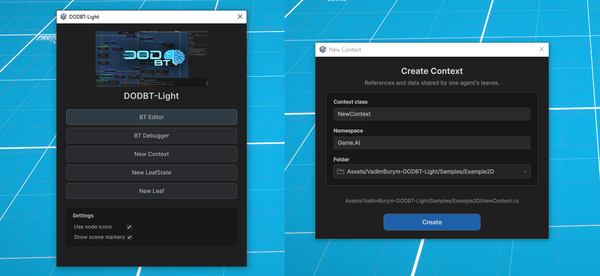
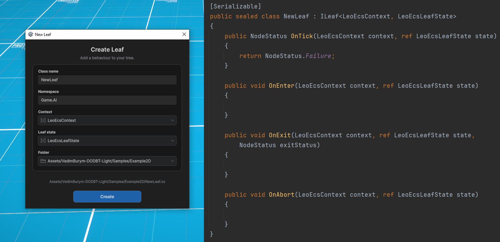
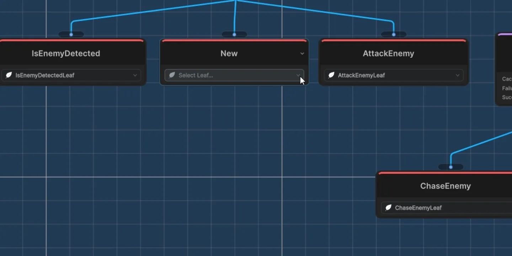
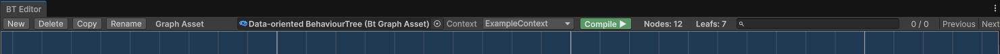
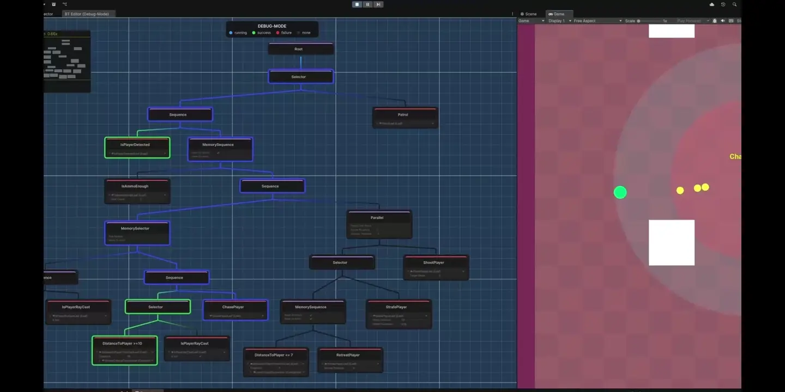

<p align="right">
  🌐 <strong>Русский</strong> &nbsp;|&nbsp; <a href="DOCUMENTATION-en.md">English</a>
</p>

<p align="center">
  <a href="../README.md#installation">Установка</a> &nbsp;·&nbsp;
  <a href="../VadimBurym-DODBT-Dots/DOCUMENTATION-ru.md">DODBT-Dots</a> &nbsp;·&nbsp;
  <a href="Samples~/Example2D/README-RU.md">Example2D</a> &nbsp;·&nbsp;
  <a href="LICENSE.md">Лицензия</a>
</p>

<h1 align="center">DODBT-Light</h1>

<p align="center">Деревья поведения для Unity на чистом C#.</p>

<p align="center">
  
  
  
  
</p>

> [!IMPORTANT]
> Light подходит для проектов, которым не требуется выполнять дерево внутри Burst Jobs. Здесь меньше ограничений, чем в [DODBT-Dots](../VadimBurym-DODBT-Dots/DOCUMENTATION-ru.md): контекст может хранить обычные C#-ссылки, состояние листа вы определяете сами, зависимости можно передавать через DI.

> [!IMPORTANT]
> Руководство предполагает, что вы уже знакомы с Behaviour Tree. Общая теория алгоритма здесь не рассматривается.

> [!IMPORTANT]
> Текущая интеграция Light и Example2D проверялась в **Unity 6000.3.10f1**, а также в **Unity 6000.0.51f1**. Зависимости [Example2D](Samples~/Example2D/README-RU.md) нужны самому примеру, а не ядру плагина.

> [!WARNING]
> Переход с DODBT 0.4.0: простая замена папки старого DODBT не является миграцией. Обновите `using`, ссылки asmdef и сериализованные имена типов `SerializeReference`; часть GUID скриптов также отличается. Работайте с копией проекта и проверьте графы и compiled-ассеты. Прилагаемый Example2D уже перенесен.

> [!TIP]
> DODBT-Light изначально создавался для удобной интеграции в ECS-архитектуру, но не привязан к ней: его можно использовать и в проектах с ООП, и с собственными игровыми системами на C#.

<h2 align="center">Содержание</h2>

- [Контекст](#context)
- [Состояние листа](#leaf-state)
- [Листья](#leaves)
  - [Жизненный цикл](#leaf-lifecycle)
  - [Настройки и состояние](#leaf-settings)
  - [Пример простого листа-условия](#condition-example)
  - [Пример сложного поведенческого листа](#action-example)
- [Редактор графов](#graph-editor)
  - [Создание ассета дерева](#create-graph)
  - [Построение графа](#graph-editing)
  - [Декораторы](#decorators)
  - [Quality of Life](#quality-of-life)
  - [Компиляция и сообщения](#compilation)
- [Интеграция в проект](#integration)
  - [Создание runtime-дерева](#create-tree)
  - [Dependency Injection](#dependency-injection)
  - [Подготовка агента](#agent-state)
  - [Выполнение дерева](#tree-execution)
  - [Отмена и повторное использование](#abort-and-pooling)
- [Отладка](#debugging)
  - [Подключение отладки](#debug-integration)
  - [Режим отладки и наблюдения](#debugger-window)
- [Пример Example2D](#example)
- [Ограничения и особенности](#limitations)
- [Тесты и производительность](#tests)
- [Лицензия](#license)
- [Публичный API](#public-api)
  - [BtContextAttribute](#api-bt-context)
  - [BtLeafStateAttribute](#api-bt-leaf-state)
  - [ILeaf&lt;TContext, TLeafState&gt;](#api-ileaf-generic)
  - [ILeaf](#api-ileaf)
  - [LeafIconAttribute](#api-leaf-icon)
  - [NodeStatus](#api-node-status)
  - [BehaviourTreeAsset](#api-behaviour-tree-asset)
  - [BehaviourTree&lt;TContext, TLeafState&gt;](#api-behaviour-tree)
  - [BtState&lt;TLeafState&gt;](#api-bt-state)
  - [BtMonoDebug](#api-bt-mono-debug)
  - [IBtDebugState](#api-debug-state)

<a id="context"></a>

<h2 align="center">Контекст</h2>

В окне **Tools → VadimBurym → DODBT-Light** нажмите **New Context**. Укажите имя класса, namespace и папку.

<p align="center">
  <a href="docs~/images/01-create-context.webp"></a>
</p>

**Контекст — данные и зависимости, которые дерево получает при выполнении конкретного агента.**

Это обычный класс: в нем могут находиться идентификатор агента, ссылки на компоненты Unity, ECS-пулы и игровые сервисы. Набор полей определяет ваш проект.

<a id="context-example"></a>

#### Пример контекста из Example2D

В [LeoEcsContext](Samples~/Example2D/BehaviourTree/LeoEcsContext.cs) достаточно индекса ECS-сущности. Общие зависимости получают сами листья на этапе подготовки.

```csharp
[BtContext]
public sealed class LeoEcsContext
{
    public int AgentIndex;
}
```

> [!NOTE]
> Атрибут `[BtContext]` нужен для удобства создания и выбора типов в редакторе; отдельной кодогенерации в Light нет.

<a id="leaf-state"></a>

<h2 align="center">Состояние листа</h2>

В окне **Tools → VadimBurym → DODBT-Light** нажмите **New LeafState** и создайте свою структуру.

**LeafState хранит изменяемые данные одного узла листа у одного агента.**

Это могут быть таймер, счетчик, цель или идентификатор отдельного игрового действия. Два узла одного класса получают разные состояния. Все такие элементы агента находятся в `BtState<TLeafState>.LeafStates`.

<a id="leaf-state-example"></a>

#### Пример состояния из Example2D

[LeoEcsLeafState](Samples~/Example2D/BehaviourTree/LeoEcsLeafState.cs) хранит индекс сущности действия в мире `BT_STATES`:

```csharp
[Serializable, BtLeafState]
public struct LeoEcsLeafState
{
    public int StateIndex;

    public void Reset()
    {
        StateIndex = -1;
    }
}
```

Отдельная система обрабатывает сущность действия, а лист через `StateIndex` проверяет результат и удаляет действие при завершении или отмене. Это та же роль, что у `StateEntity` в Dots, но формат состояния в Light вы задаете сами.

> [!IMPORTANT]
> `Reset()` в этом примере — ваш метод, а не контракт плагина. Раннер не вызывает его автоматически. После `FillInitialState` задайте начальные значения пользовательских полей; при возврате состояния из пула сначала завершите прежние действия.

> [!NOTE]
> Атрибут `[BtLeafState]` нужен для удобства создания и выбора типов в редакторе; отдельной кодогенерации в Light нет.

<a id="leaves"></a>

<h2 align="center">Листья</h2>

Нажмите **New Leaf**, выберите **Context**, **Leaf state**, namespace и папку. Шаблон создает сериализуемый класс с интерфейсом `ILeaf<TContext, TLeafState>` и четырьмя методами жизненного цикла.

<p align="center">
  <a href="docs~/images/02-create-leaf.webp"></a>
</p>

Листья - конечные узлы дерева, которые могут быть проверками условий, конкретными действиями или состояниями, выполняемые в контексте агента и обладающие собственным состоянием выполнения. Редактор графов сам найдет их в вашем проекте и предложит в качестве выбора при добавлении листа.

Лист относится к конкретной паре типов. Например, `ILeaf<LeoEcsContext, LeoEcsLeafState>` подходит только к графу с этой парой;

<a id="leaf-lifecycle"></a>

### Жизненный цикл

<table width="100%">
<thead>
<tr>
<th width="32%" align="left">Метод</th>
<th width="68%" align="left">Когда вызывается</th>
</tr>
</thead>
<tbody>
<tr>
<td><code>OnEnter(context, ref state)</code></td>
<td>Вход в неактивный лист перед первым <code>OnTick</code>. Здесь обычно запускается действие.</td>
</tr>
<tr>
<td><code>OnTick(context, ref state)</code></td>
<td>Проверка условия или результата действия. Возвращает <code>Running</code>, <code>Success</code> либо <code>Failure</code>.</td>
</tr>
<tr>
<td><code>OnExit(context, ref state, exitStatus)</code></td>
<td>Завершение после <code>Success</code> или <code>Failure</code>; результат передается в <code>exitStatus</code>.</td>
</tr>
<tr>
<td><code>OnAbort(context, ref state)</code></td>
<td>Отмена активного листа. Дополнительный <code>OnExit</code> при отмене не вызывается.</td>
</tr>
</tbody>
</table>

Пока лист возвращает `Running`, повторного `OnEnter` нет. `OnEnter` и первый `OnTick` выполняются в одном вызове дерева.

> [!WARNING]
> При переключении веток новые Enter/Tick происходят **до Abort прежней Running-ветки**. Не стройте взаимное исключение действий на предположении, что старое действие всегда будет снято первым. Для отдельных сущностей действий полезны явный владелец и независимое завершение каждой операции.

<a id="leaf-settings"></a>

### Настройки и состояние

<table width="100%">
<thead>
<tr>
<th width="32%" align="left">Где хранить</th>
<th width="68%" align="left">Что хранить</th>
</tr>
</thead>
<tbody>
<tr>
<td>Поля класса листа</td>
<td>Общие для всех настройки листа и подготовленные зависимости: настраиваемые поля, ECS-пулы, сервисы.</td>
</tr>
<tr>
<td><code>TContext</code></td>
<td>Данные и зависимости конкретного агента, доступные всем его листьям.</td>
</tr>
<tr>
<td><code>TLeafState</code></td>
<td>Изменяемое состояние конкретного узла у конкретного агента.</td>
</tr>
</tbody>
</table>

Добавьте `[Serializable]` к классу листа, `[SerializeField]` к приватным настройкам и `[SerializeReference]` к полиморфным вложенным данным. Настройки редактируются внутри ноды и в Редакторе графов. Упаковывать их как в Dots-версии не требуется.

> [!WARNING]
> Экземпляры листьев общие для всех агентов, использующих дерево. Не храните в полях листа текущую цель, таймер или состояние отдельного агента: следующий агент перезапишет эти данные. Для них предназначены контекст и LeafState.

<a id="condition-example"></a>

### Пример простого листа-условия

В примере приведен лист `IsPlayerRayCastLeaf` (агент проверяет видимость игрока) с использованием фреймворка `LeoEcsLite`. Лист получает необходимые зависимости через DI `[Inject]` - ECS-пул с данными сенсоров у агентов. В `OnTick` по индексу текущего агента он берет его сенсор из общего пула и проверяет значение. За RayCast и логику сенсора отвечает отдельная ECS-система, которая пишет данные в сенсор.
```csharp
[Serializable]
public sealed class IsPlayerRayCastLeaf : ILeaf<LeoEcsContext, LeoEcsLeafState>
{
    private EcsPool<PlayerVisibilitySensor> _sensorPool;

    [Inject]
    public void Construct(IEcsWorldsService service)
    {
        _sensorPool = service.GetPool<PlayerVisibilitySensor>(EcsWorlds.DEFAULT);
    }

    public NodeStatus OnTick(LeoEcsContext context, ref LeoEcsLeafState state)
    {
        return _sensorPool.Get(context.AgentIndex).IsPlayerRaycast ? NodeStatus.Success : NodeStatus.Failure;
    }

    public void OnEnter(LeoEcsContext context, ref LeoEcsLeafState state) { }
    public void OnExit(LeoEcsContext context, ref LeoEcsLeafState state, NodeStatus exitStatus) { }
    public void OnAbort(LeoEcsContext context, ref LeoEcsLeafState state) { }
}
```

> [!NOTE]
> Как настроить работу через DI описано в разделе [Dependency Injection](#dependency-injection). Аналогично можно использовать и ServiceLocator и передавать зависимости через Context.

<a id="action-example"></a>

### Пример сложного поведенческого листа

В примере приведен лист `ShootPlayerLeaf` (агент стреляет в игрока) с использованием фреймворка `LeoEcsLite`. Лист получает необходимые зависимости через DI `[Inject]` - ECS-мир и ECS-пулы сенсоров и состояний у агентов. В `OnEnter` лист обращается к сенсору текущего агента из `Context`, получает информацию о сущности игрока в поле зрения и создает в мире новую сущность-действие, которую будет обрабатывать другая ECS-система, отвечающая за стрельбу. В `OnTick` лист проверяет статус созданной им сущности. Если действие прекратится по какой-то причине (например закончились патроны или игрока больше не видно), другая ECS-система сменит статус действия, а лист это прочитает и вернет Failure/Success вместо Running. В `OnExit` и `OnAbort` лист принудительно удаляет эту сущность-действие которую он создал.

> [!NOTE]
> Сам процесс стрельбы здесь выполняет ваша отдельная ECS-система, которая обрабатывает компонент `ShootEntityState`. Лист лишь создает/удаляет для текущего агента сущность с этим компонентом в мир и наблюдает за ее состоянием.
```csharp
[Serializable]
public sealed class ShootPlayerLeaf : ILeaf<LeoEcsContext, LeoEcsLeafState>
{
    [SerializeField] private int _targetShots;

    private EcsWorld _world;
    private EcsPool<AgentEntity> _agentPool;
    private EcsPool<ShootEntityState> _shootStatePool;
    private EcsPool<PlayerVisibilitySensor> _sensorPool;

    [Inject]
    public void Construct(IEcsWorldsService service)
    {
        _world = service.GetWorld(EcsWorlds.BT_STATES);
        _agentPool = service.GetPool<AgentEntity>(EcsWorlds.BT_STATES);
        _shootStatePool = service.GetPool<ShootEntityState>(EcsWorlds.BT_STATES);
        _sensorPool = service.GetPool<PlayerVisibilitySensor>(EcsWorlds.DEFAULT);
    }

    public NodeStatus OnTick(LeoEcsContext context, ref LeoEcsLeafState state)
    {
        var status = _shootStatePool.Get(state.StateIndex).StateStatus;
        return status == NodeStatus.None ? NodeStatus.Running : status;
    }

    public void OnEnter(LeoEcsContext context, ref LeoEcsLeafState state)
    {
        var playerIndex = _sensorPool.Get(context.AgentIndex).DetectedPlayer;
        state.StateIndex = _world.NewEntity();
        _agentPool.Add(state.StateIndex).AgentIndex = context.AgentIndex;
        _shootStatePool.Add(state.StateIndex).Setup(
            targetShots: _targetShots,
            entityIndex: playerIndex);
    }

    public void OnExit(LeoEcsContext context, ref LeoEcsLeafState state, NodeStatus exitStatus)
    {
        _world.DelEntity(state.StateIndex);
    }

    public void OnAbort(LeoEcsContext context, ref LeoEcsLeafState state)
    {
        _world.DelEntity(state.StateIndex);
    }
}
```
> [!NOTE]
> Как настроить работу через DI описано в разделе [Dependency Injection](#dependency-injection). Аналогично можно использовать и ServiceLocator и передавать зависимости через Context.

> [!TIP]
> **Рекомендуемая роль листа — связать решение дерева с игровыми системами.** Условие читает сенсор, действие запускает операцию, `Running` ожидает результат, `Exit/Abort` завершают ее. Короткие вычисления допустимы прямо в листе; длительное движение, стрельбу и анимацию удобнее обновлять отдельными системами.

<a id="graph-editor"></a>

<h2 align="center">Редактор графов</h2>

Откройте **Tools → VadimBurym → DODBT-Light** и нажмите **BT Editor**.

<p align="center">
  <a href="docs~/images/03-editor-overview.webp"></a>
</p>

<a id="create-graph"></a>

### Создание ассета дерева

<p align="center">
  <a href="docs~/images/08-create-graph.webp"></a>
</p>

Нажмите **New**. Укажите имя, папку, **Context** и **LeafState**. Редактор создаст граф `BtGraphAsset` и связанный с ним compiled-ассет `BehaviourTreeAsset`.

Пара **Context + LeafState** определяет доступные листья. Обе настройки можно менять в верхней панели. Уже настроенные несовместимые узлы сохраняются, получают оранжевую рамку и warning-иконку; перед компиляцией замените их подходящими листьями.

**Copy** создает отдельное дерево со своим compiled-ассетом. **Rename** переименовывает пару, **Delete** удаляет выбранный граф и принадлежащий ему compiled-ассет после подтверждения.

<a id="graph-editing"></a>

### Построение графа

Нажмите правой кнопкой по свободному месту и выберите **Add → тип ноды**. Соедините выход родителя со входом ребенка. У Root один ребенок; у каждого другого узла один родитель. Порядок выполнения детей определяется расположением **слева направо**.

Для Leaf выберите реализацию в поле с иконкой листа.

<p align="center">
  <a href="docs~/images/07-select-leaf.webp"></a>
</p>

<table width="100%">
<thead>
<tr>
<th width="32%" align="left">Нода</th>
<th width="68%" align="left">Поведение</th>
</tr>
</thead>
<tbody>
<tr>
<td>Root</td>
<td>Указывает точку входа в граф.</td>
</tr>
<tr>
<td>Leaf</td>
<td>Пользовательское условие или действие.</td>
</tr>
<tr>
<td>Sequence</td>
<td>Проверяет детей слева направо до Failure или Running. Новый Tick начинает проверку сначала.</td>
</tr>
<tr>
<td>Selector</td>
<td>Ищет первого ребенка с Success или Running. Новый Tick снова проверяет детей слева.</td>
</tr>
<tr>
<td>MemorySequence</td>
<td>Продолжает с сохраненного ребенка. <code>Reset On Failure</code> задает сброс при Failure, <code>Reset On Abort</code> — при отмене. После общего Success начинает заново.</td>
</tr>
<tr>
<td>MemorySelector</td>
<td>Сохраняет позицию выполнения. <code>Pick Random</code> меняет порядок выбора, <code>Reset On Abort</code> управляет сбросом при отмене.</td>
</tr>
<tr>
<td>Parallel</td>
<td>Обходит ветки и сравнивает результаты с порогами Success/Failure. <code>Cache Child Status</code> позволяет не тикать уже завершившихся детей повторно в текущей попытке.</td>
</tr>
</tbody>
</table>

> [!TIP]
> Подробное описание устройства каждой ноды можно посмотреть в подсказках редактора в панели **Details**.

<p align="center">
  <a href="docs~/images/05-parallel-details.webp"></a>
</p>

> [!IMPORTANT]
> Parallel не создает потоки: ветки одного дерева выполняются последовательно в текущем вызове. Light-версия не превращает обычные C#-листья в Burst Jobs.

> [!TIP]
> Несвязанные с Root узлы можно оставить как черновики. В скомпилированное дерево они не входят.

<a id="decorators"></a>

### Декораторы

Для Timeout, Cooldown и Inverter добавьте `DODBT_DECORATORS` в **Scripting Define Symbols** выбранной платформы. В меню Add появятся декораторы; у каждого должен быть ровно один ребенок.

<table width="100%">
<thead>
<tr>
<th width="32%" align="left">Декоратор</th>
<th width="68%" align="left">Поведение</th>
</tr>
</thead>
<tbody>
<tr>
<td>Timeout</td>
<td>Ограничивает время попытки. На достигнутом сроке отменяет активного ребенка и возвращает Failure. После отмены новая попытка получает новый интервал.</td>
</tr>
<tr>
<td>Cooldown</td>
<td>Первая попытка доступна сразу. После Success или Failure ребенка блокирует новые попытки на заданное время, возвращая Failure. Abort активной попытки сам по себе не запускает задержку; уже начавшаяся задержка сохраняется.</td>
</tr>
<tr>
<td>Inverter</td>
<td>Меняет Success на Failure и наоборот; Running остается Running.</td>
</tr>
</tbody>
</table>

Для Timeout и Cooldown передавайте время в секундах:

```csharp
#if DODBT_DECORATORS
NodeStatus result = tree.TickWithStatus(context, state, Time.timeAsDouble);
#endif
```

> [!IMPORTANT]
> `now` должен быть конечным числом и не уменьшаться в пределах инициализированного состояния агента. Используйте одни часы на протяжении его жизни. Таймеры проверяются при посещении ветки: редкие тики не превращаются в фоновое выполнение между вызовами дерева.

Если убрать директиву, данные декораторов сохранятся в графе, но компиляция и создание runtime-дерева с ними будут отклонены. Inverter без временных декораторов допускает обычный Tick без аргумента времени.

<a id="quality-of-life"></a>

### Quality of Life

Плагин постоянно развивается и получает новые улучшения удобства работы. Эти улучшения относятся только к **authoring — созданию, настройке и редактированию деревьев** — и не затрагивают их выполнение в рантайме. Если вам чего-то не хватает или какой-то шаг можно упростить — делитесь идеями и обратной связью. Ваши предложения помогают определять, что появится в следующих обновлениях. Предложения по удобству работы можно оставлять в [обсуждениях DODBT](https://github.com/vadimburym/DODBT/discussions).

Что уже есть:

- Панель **Details** с настройками, возможностью переименовать, сверить порядок выполнения дочерних нод и посмотреть подсказки по устройству каждой ноды.
- Панель **Output** с логами, ошибками и причинами неудачной компиляции.
- **Поиск** по именам нод, типам и namespace; **Previous / Next** перемещают выделение между результатами.
- **Copy / Paste / Duplicate** копируют ноды или выделенный блок с внутренними связями и независимыми настройками. Root не копируется.
- **Связанные группы:** на корне ветки выберите **Create Linked Group**, затем **Duplicate Group**. Изменения структуры, параметров и относительных позиций синхронизируются. **Unlink Group** делает экземпляр независимым; список находится на вкладке **Groups**.
- **Окна создания** запоминают папку и последние параметры. Выбор контекста, состояния и листа поддерживает поиск.
- **Use node icons** в окне запуска включает компактные композитные ноды c иконками. Также вы можете добавить LeafIconAttribute чтобы задать собственную иконку листа по GUID текстуры или пути в Assets/ Packages/.
- **Undo / Redo** работают для поддерживаемых операций редактирования графа.

> [!NOTE]
> Связанные группы существуют только в редакторе. При компиляции каждый экземпляр становится обычными нодами с собственными состояниями. Группы не могут пересекаться или вкладываться друг в друга.

<p align="center">
  <a href="docs~/images/06-linked-groups.webp"></a>
</p>

<a id="compilation"></a>

### Компиляция и сообщения

Нажмите **Compile**, чтобы записать результат в `BehaviourTreeAsset`. В игре используйте этот ассет; граф с позициями нод и группами нужен редактору.

<p align="center">
  <a href="docs~/images/04-editor-toolbar.webp"></a>
</p>

<table width="100%">
<thead>
<tr>
<th width="32%" align="left">Причина ошибки</th>
<th width="68%" align="left">Что проверить</th>
</tr>
</thead>
<tbody>
<tr>
<td>У Root нет ветки</td>
<td>Соедините точку входа с деревом.</td>
</tr>
<tr>
<td>Leaf пустой или его класс удален</td>
<td>Назначьте реализацию либо восстановите скрипт и сериализованные данные.</td>
</tr>
<tr>
<td>Не совпадают Context или LeafState</td>
<td>Выберите правильную пару у графа и совместимые листья.</td>
</tr>
<tr>
<td>Цикл, несколько родителей или некорректная связь</td>
<td>Исправьте соединения.</td>
</tr>
<tr>
<td>Неверное число детей или пороги</td>
<td>Проверьте композитные ноды и единственного ребенка декоратора.</td>
</tr>
<tr>
<td>Декораторы отключены</td>
<td>Включите <code>DODBT_DECORATORS</code> для нужной платформы или удалите декораторы из дерева.</td>
</tr>
</tbody>
</table>


<a id="integration"></a>

<h2 align="center">Интеграция в проект</h2>

<a id="create-tree"></a>

### Создание runtime-дерева

Создайте один `BehaviourTree<TContext, TLeafState>` для выбранного compiled-ассета перед запуском агентов:

```csharp
// compiledAsset — BehaviourTreeAsset, полученный после Compile в Редакторе графов.
var tree = new BehaviourTree<LeoEcsContext, LeoEcsLeafState>();
tree.Construct(compiledAsset);
```

Типы должны соответствовать паре графа. В Example2D деревья создаются в [BehaviourTreeWarmUpSystem](Samples~/Example2D/BehaviourTree/BehaviourTreeWarmUpSystem.cs) и хранятся в [BehaviourTreeService](Samples~/Example2D/BehaviourTree/BehaviourTreeService.cs) для постоянного доступа к ним в любой момент геймплея.

> [!TIP]
> Используйте одно подготовленное дерево для всех агентов с одинаковым поведением и общими зависимостями. Не создавайте одно и то же отдельное `BehaviourTree` на каждого агента.

<a id="dependency-injection"></a>

### Dependency Injection

**DI — передача объекту зависимостей, которые он использует.** DODBT не навязывает контейнер: общие сервисы и ECS-пулы можно один раз передать листьям, а данные конкретного агента — через контекст.

Подготовку выполняйте после `tree.Construct(compiledAsset)` и до первого тика. `tree.Leafs` дает доступ к экземплярам листьев скомпилированного дерева.

<a id="di-container"></a>

#### Через DI-контейнер

Передайте зависимости каждому листу через выбранный контейнер:

```csharp
foreach (var leaf in tree.Leafs)
    DiContainer.Inject(leaf);
```

`DiContainer.Inject` здесь обозначает API выбранного вами DI-контейнера, а не метод DODBT. Атрибут `[Inject]` и способ регистрации зависимостей также принадлежат контейнеру. Он должен уметь внедрять зависимости в уже созданные экземпляры; отдельный контейнер для каждого агента не нужен, если зависимости общие. Выполните это 1 раз перед стартом игры при сборке дерева.

<a id="service-locator"></a>

#### Через ServiceLocator

В Example2D используется собственный контракт `IConstruct`. [BehaviourTreeLeafsConstructSystem](Samples~/Example2D/BehaviourTree/BehaviourTreeLeafsConstructSystem.cs) вызывает подготовку каждого листа:

```csharp
foreach (var leaf in tree.Leafs)
{
    if (leaf is IConstruct constructable)
        constructable.Construct();
}
```

Это код интеграции Example2D, не обязательные службы плагина. Чтобы реализовать это, вам нужно добавить листьям свой контракт (например `IConstruct`) и внутри метода взять все необходимые зависимости из `ServiceLocator`. Аналогично DI-контейнеру соберите листья 1 раз перед стартом игры при сборке дерева.

<a id="context-dependencies"></a>

#### Через контекст

Для небольшого проекта достаточно полей контекста. Например, ссылка на `Transform` агента или готовый `EcsPool<PlayerVisibility>` передается при создании его контекста; лист обращается к ним через аргумент `context`.

> [!WARNING]
> Общие листья должны получать общие зависимости. Если два игровых мира используют разные DI-контейнеры, не перенастраивайте один и тот же набор листьев под второй мир: `Construct` не клонирует листья compiled-ассета. Для независимых окружений нужны независимые экземпляры этих данных, например отдельная runtime-копия ассета, либо зависимости, передаваемые через контекст.

<a id="agent-state"></a>

### Подготовка агента

Для каждого агента при его сборке создайте собственные контекст и `BtState<TLeafState>`. Инициализируйте состояние от того дерева, которое будет его исполнять:

```csharp
// agent — индекс уже созданной сущности LeoEcsLite.
var context = new LeoEcsContext { AgentIndex = agent };
var state = new BtState<LeoEcsLeafState>();
tree.FillInitialState(state);

for (int i = 0; i < state.LeafStates.Length; i++)
    state.LeafStates[i].Reset();
```

`FillInitialState` подготавливает служебное состояние обхода и выделяет массивы при недостаточной емкости. В цикле выше `Reset()` задает пользовательское начальное значение `StateIndex = -1`. Пример создания противника — [EnemyFactory](Samples~/Example2D/Gameplay/Enemies/EnemyFactory.cs).

> [!IMPORTANT]
> `BtState<TLeafState>` — класс. Одно его состояние нельзя передавать нескольким агентам. Длина `LeafStates` может включать запас емкости и быть больше фактического числа листьев дерева.

<a id="tree-execution"></a>

### Выполнение дерева

Вызывайте дерево для каждого агента, передавая его `context` и `state` с нужной вашей игре частотой:

```csharp
tree.Tick(context, state);
```

Если вызывающему коду нужен результат, используйте вместо него:

```csharp
NodeStatus result = tree.TickWithStatus(context, state);
```

Это два варианта одного вызова: используйте один из них. `TickWithStatus` выполняет обход и возвращает `Running`, `Success` или `Failure`; `Tick` отбрасывает результат.

В [AiBrainTickSystem](Samples~/Example2D/BehaviourTree/AiBrainTickSystem.cs) у каждого агента собственный интервал тика. Частота дерева может быть ниже частоты движения, сенсоров и стрельбы. Для деревьев с временными декораторами используйте перегрузку с `now`, как показано в разделе [Декораторы](#decorators).

<a id="abort-and-pooling"></a>

### Отмена и повторное использование

Перед смертью агента, сменой дерева или возвратом в пул отмените активные действия:

```csharp
tree.Abort(context, state);

#if UNITY_EDITOR
if (owner.TryGetComponent<BtMonoDebug>(out var debug))
    debug.Detach();
#endif
```

При повторной выдаче агента настройте контекст, вызовите `FillInitialState`, сбросьте свои поля LeafState и заново подключите отладку. Пулы Context и BtState можно реализовать в интеграции.

> [!WARNING]
> `FillInitialState` не вызывает `OnAbort`, не удаляет сущности действий и не сбрасывает уже существующие пользовательские LeafState. Сначала корректно завершите поведение. Сам `Abort` не отключает AI навсегда: следующий Tick снова может запустить дерево.

<a id="debugging"></a>

<h2 align="center">Отладка</h2>

<p align="center">
  <a href="docs~/images/09-example2d-observe.webp"></a>
</p>

<a id="debug-integration"></a>

### Подключение отладки

После `FillInitialState` свяжите объект на сцене, compiled-ассет и состояние агента:

```csharp
#if UNITY_EDITOR
BtMonoDebug.Attach(owner, compiledAsset, state);
#endif
```

`owner` — GameObject агента. Компонент создается или переиспользуется автоматически. При смене дерева или состояния вызовите `Attach` повторно; при возврате состояния в пул — `Detach`.

> [!IMPORTANT]
> Подключение выполняется один раз при подготовке агента. Дополнительный Tick для отладки не нужен: обычный `Tick` или `TickWithStatus` в Editor уже записывает статусы. Не вызывайте `FillInitialState` каждый кадр — это сбросит выполнение.

Если `BtMonoDebug` уже добавлен на объект, можно вызвать `debug.Construct(compiledAsset, state)`. Его `RunningLeafs` содержит имена активных листьев и подходит для собственных редакторских подписей.

<a id="debugger-window"></a>

### Режим отладки и наблюдения

В окне **Tools → VadimBurym → DODBT-Light** нажмите **BT Debugger**. Окно показывает подключенных агентов, их деревья и активные листья, поддерживает поиск и страницы. Нажмите **Observe**, чтобы открыть дерево конкретного агента.

Для открытия со сцены включите **Settings → Show scene markers** в окне запуска. Выделите агента или его дочерний объект в Scene View и нажмите **Observe** над ним.

Статусы узлов: синий — Running, зеленый — Success, красный — Failure, серый — None. В Observe доступны поиск и просмотр настроек. Если ассет или его ревизия больше не совпадают с состоянием агента, редактор останавливает наблюдение вместо отображения чужих данных.

> [!NOTE]
> Визуальная отладка работает в Unity Editor во время Play Mode. Методы подключения и данные трассировки доступны под `UNITY_EDITOR`; это не отладчик готового player. Само ядро дерева не требует MonoBehaviour — он нужен только для привязки агента к сцене и редактору.

Если агент не появился, проверьте порядок `Construct → FillInitialState → Attach`, правильность compiled-ассета и факт выполнения Tick. После изменения графа перекомпилируйте его и пересоздайте runtime-состояние.

<a id="example"></a>

<h2 align="center">Пример Example2D</h2>

[Example2D](Samples~/Example2D/README-RU.md) — небольшая 2D-игра на LeoEcsLite и ServiceLocator. Противник патрулирует, обнаруживает игрока, преследует его, отступает и стреляет. Игровая сцена — [Example2D.unity](Samples~/Example2D/Example2D.unity), дерево — [ExampleBrain](Samples~/Example2D/BehaviourTree/Assets/ExampleBrain.asset).

При установке через UPM импортируйте **Samples → LeoECS 2D Example** после установки зависимостей, перечисленных в README примера. Если пример уже лежит в `Assets` вместе с плагином, откройте сцену напрямую. Управление: **WASD** или стрелки.

> [!NOTE]
> Пример показывает подключение плагина и не является рекомендацией по архитектуре игры. LeoECS, навигация, ввод и рендеринг относятся к примеру; подключать их в проект ради самого DODBT-Light не требуется.

<a id="limitations"></a>

<h2 align="center">Ограничения и особенности</h2>

**В Light ограничений заметно меньше, чем в Dots.** Нет фиксированного LeafData, требования unmanaged или статических методов листа. Можно использовать обычные C#-объекты, Unity-ссылки и DI. Основные правила связаны с сериализацией и разделением общих данных и состояния агента.

<a id="type-limits"></a>

### Типы и сериализация

- `TContext` должен быть классом, `TLeafState` — структурой. Их содержимое определяет пользователь.
- Один граф привязан к одной паре типов; листья должны соответствовать этой паре.
- Поля настройки сохраняются по правилам сериализации Unity. Произвольное свойство или неподдерживаемая коллекция не становится сериализуемой автоматически.
- Общие игровые зависимости внедряются после создания runtime-дерева; редакторские окна и сериализация не выполняют DI за вас.

<a id="shared-tree-limits"></a>

### Общие листья и порядок выполнения

Один экземпляр дерева вызывается последовательно для разных агентов. Внутри есть общие рабочие буферы и экземпляры листьев, поэтому параллельные и вложенные повторные вызовы того же экземпляра не поддерживаются. Для Burst Jobs используйте Dots.

У каждого агента собственный BtState. Не меняйте общие настройки листьев во время выполнения и не храните в них данные конкретного агента. Аллокации внутри ваших методов листа и используемых сервисов остаются под вашим контролем.

<a id="size-limits"></a>

### Размер дерева и директивы

- До **65 535 исполняемых узлов**, либо **255** с `DODBT_SMALL_SIZE`. Редакторский Root не входит в это число.
- До **255 детей** у композита; у декоратора ровно один ребенок.
- `DODBT_DECORATORS` включает Timeout, Cooldown и Inverter. Для временных декораторов нужны монотонные часы.

> [!IMPORTANT]
> После смены директив перекомпилируйте графы и пересоздайте runtime-деревья и состояния. Если сборки используют разные наборы директив, согласуйте их. Изменение графа в редакторе не является автоматическим обновлением уже выполняющихся агентов.

<a id="tests"></a>

<h2 align="center">Тесты и производительность</h2>

Тесты входят в пакет: [Tests](Tests). Они проверяют ноды, жизненный цикл, независимость состояний агентов, компиляцию и сериализацию, пары Context/LeafState, декораторы, связанные группы и отладку.

Для UPM добавьте пакет в `testables` корневого `Packages/manifest.json`, сохранив остальные записи:

```json
"testables": [
  "com.vadimburym.dodbt.light"
]
```

Для запуска нужен пакет **Unity Test Framework**. Откройте **Window → General → Test Runner** и запустите EditMode-тесты. Проверки декораторов зависят от `DODBT_DECORATORS`; тесты выделены в редакторскую сборку и не нужны обычному player.

> [!TIP]
> `Construct` и первоначальный `FillInitialState` выполняют выделение памяти заранее. После подготовки обычный обход дерева не требует создавать новые объекты на каждый Tick; в тестах есть проверки аллокаций. Частоту обновления выбирает ваша система. Измеряйте свои листья и игровую нагрузку отдельно, после прогрева и без открытого Observe.

Результаты Dots с Burst и Jobs не являются замерами Light: это другой способ выполнения. Для Light выигрыш дают общий экземпляр дерева, отдельное компактное состояние агента и управляемая частота тиков.

<a id="license"></a>

<h2 align="center">Лицензия</h2>

Плагин и его документация распространяются по [DODBT Custom Game-Use and Redistribution License](LICENSE.md), общей для DODBT-Light и DODBT-Dots. Полный текст также находится в [общем LICENSE](../LICENSE.md).

Код Example2D имеет отдельную [MIT-лицензию](Samples~/Example2D/LICENSE.md). Внешние библиотеки сохраняют лицензии своих авторов.

<a id="public-api"></a>

<h2 align="center">Публичный API</h2>

Типы для создания поведения, подготовки дерева, выполнения и подключения отладки. Пространство имен — `VadimBurym.DodBehaviourTree.Light`. Ниже `TContext` обозначает ваш класс контекста, `TLeafState` — вашу структуру состояния листа.

---

<a id="api-bt-context"></a>

### **`BtContextAttribute`**

**Тип:** атрибут класса контекста.

**Принимает:** нет аргументов либо `Type leafStateType` — тип состояния по умолчанию для редактора.

**Свойства:**

- **`LeafStateType`** — `Type`, только чтение. Подсказка для выбора LeafState; без аргумента равна `null`.

**Описание:** делает контекст доступным в окнах создания и редакторе графа до появления первого листа. Указанный LeafState является подсказкой, а не запретом на другие пары типов. Атрибут не внедряет зависимости и не генерирует раннер.

---

<a id="api-bt-leaf-state"></a>

### **`BtLeafStateAttribute`**

**Тип:** атрибут структуры состояния листа.

**Принимает:** нет аргументов.

**Описание:** добавляет тип в списки LeafState в редакторе. Поля структуры и их начальные значения определяет пользователь. Контексты и состояния без атрибутов также обнаруживаются через реализации `ILeaf<TContext, TLeafState>`.

---

<a id="api-ileaf-generic"></a>

### **`ILeaf<TContext, TLeafState>`**

**Тип:** интерфейс класса листа; наследует `ILeaf`.

**Параметры типов:**

- **`TContext`** — класс контекста агента.
- **`TLeafState`** — структура состояния одного узла листа у одного агента.

**Состав:** `OnEnter`, `OnTick`, `OnExit`, `OnAbort`.

**Описание:** связывает лист с парой Context + LeafState и задает его жизненный цикл. Методы вызываются у экземпляра листа. Изменения аргумента `ref state` сохраняются в состоянии агента; поля самого листа остаются общими настройками и зависимостями.

#### **`OnEnter(context, ref state)`**

**Принимает:**

- **`context`** — `TContext`. Контекст текущего агента.
- **`state`** — `ref TLeafState`. Состояние текущего узла у этого агента.

**Возвращает:** ничего (`void`).

**Описание:** запускает поведение перед первым `OnTick` неактивного листа. Обычно создает игровое действие и сохраняет его идентификатор в состоянии. Пока лист возвращает `Running`, повторного входа нет.

#### **`OnTick(context, ref state)`**

**Принимает:** `TContext context` и `ref TLeafState state` — контекст агента и состояние текущего узла.

**Возвращает:** `NodeStatus` — `Running`, `Success` или `Failure`.

**Описание:** проверяет условие либо результат активного действия. `Running` сохраняет лист активным; `Success` и `Failure` завершают его и приводят к вызову `OnExit`.

#### **`OnExit(context, ref state, exitStatus)`**

**Принимает:**

- **`context`** — `TContext`. Контекст агента.
- **`state`** — `ref TLeafState`. Состояние завершающегося узла.
- **`exitStatus`** — `NodeStatus`. Результат `Success` или `Failure`, возвращенный листом.

**Возвращает:** ничего (`void`).

**Описание:** завершает действие после обычного выхода из листа. Используется для удаления сущности действия, освобождения ресурсов и сброса пользовательских данных.

#### **`OnAbort(context, ref state)`**

**Принимает:** `TContext context` и `ref TLeafState state` — контекст агента и состояние отменяемого узла.

**Возвращает:** ничего (`void`).

**Описание:** останавливает активное поведение при отмене ветки или всего дерева. Должен освободить связанные с ним ресурсы. Дополнительного `OnExit` при отмене не будет.

---

<a id="api-ileaf"></a>

### **`ILeaf`**

**Тип:** базовый интерфейс-маркер без методов и полей.

**Описание:** позволяет хранить листья разных реализаций в одном массиве и получать их для настройки зависимостей через `BehaviourTree.Leafs`. Для исполняемого листа реализуйте обобщенный `ILeaf<TContext, TLeafState>`.

---

<a id="api-leaf-icon"></a>

### **`LeafIconAttribute`**

**Тип:** необязательный атрибут класса листа; используется только в редакторе.

**Принимает:** `string asset` — GUID текстуры или путь внутри `Assets/` либо `Packages/`.

**Свойства:**

- **`Asset`** — `string`, только чтение. Ссылка на текстуру, переданная атрибуту.

**Описание:** задает иконку узла при включенной настройке **Use node icons**. Предпочтителен GUID: он сохраняет связь при перемещении файла. Если текстура отсутствует, лист остается в обычном виде. На выполнение дерева атрибут не влияет.

---

<a id="api-node-status"></a>

### **`NodeStatus`**

**Тип:** перечисление с базовым типом `byte`.

**Значения:**

- **`None = 0`** — служебное значение: результат еще не задан. Не используйте его как результат `OnTick`.
- **`Running = 1`** — выполнение продолжается.
- **`Success = 2`** — выполнение успешно завершено.
- **`Failure = 3`** — условие не выполнено или действие завершилось неудачей.

**Описание:** общий формат результата листьев и узлов. Возвращается из `OnTick` и `TickWithStatus`, а также отображается в Observe.

---

<a id="api-behaviour-tree-asset"></a>

### **`BehaviourTreeAsset`**

**Тип:** `ScriptableObject` со скомпилированными данными дерева.

**Свойства:**

- **`GUID`** — `string`, только чтение. Идентификатор исходного графа, сохраненный при компиляции. В примере используется как ключ в сервисе деревьев.

**Описание:** результат команды **Compile**. Содержит исполняемые узлы, связи и сериализованные экземпляры листьев. Передается в `BehaviourTree.Construct` и используется для привязки отладки. Для интеграции не требуется вручную заполнять его внутренние массивы.

---

<a id="api-behaviour-tree"></a>

### **`BehaviourTree<TContext, TLeafState>`**

**Тип:** класс выполнения дерева; `TContext : class`, `TLeafState : struct`.

**Свойства:**

- **`Leafs`** — `ILeaf[]`, только чтение свойства. Экземпляры листьев compiled-ассета для подготовки зависимостей. Элементы массива и порядок листьев заменять не следует.

**Описание:** один подготовленный экземпляр последовательно обслуживает множество агентов. Их изменяемые данные находятся в отдельных `BtState`. Дерево содержит общие рабочие буферы и не поддерживает одновременные или вложенные повторные вызовы того же экземпляра.

#### **`Construct(asset)`**

**Принимает:** `BehaviourTreeAsset asset` — скомпилированный ассет с листьями для выбранной пары типов.

**Возвращает:** ничего (`void`).

**Описание:** подготавливает дерево и рабочие буферы перед использованием. Отклоняет пустую ссылку, несовместимые данные и листья с неподходящими типами. Не клонирует экземпляры листьев из ассета. После вызова подготовьте их зависимости, затем состояния агентов.

#### **`FillInitialState(btState)`**

**Принимает:** `BtState<TLeafState> btState` — отдельное состояние агента.

**Возвращает:** ничего (`void`).

**Описание:** подготавливает массивы нужной емкости и сбрасывает служебное состояние обхода; при включенных декораторах сбрасывает и их состояние времени. Вызывается до первого тика или перед повторным использованием. Не вызывает `OnAbort` и не сбрасывает существующие пользовательские элементы `LeafStates`: завершение действий и начальные значения их полей остаются задачей интеграции.

#### **`Tick(context, state)`**

**Принимает:**

- **`context`** — `TContext`. Контекст текущего агента.
- **`state`** — `BtState<TLeafState>`. Его состояние, подготовленное этим деревом.

**Возвращает:** ничего (`void`).

**Описание:** выполняет один обход дерева. Частоту вызова задает игра. В редакторе также записывает диагностические статусы; дополнительный вызов для Observe не нужен. Для дерева с Timeout или Cooldown требуется перегрузка с `now`.

#### **`TickWithStatus(context, state)`**

**Принимает:** `TContext context` и `BtState<TLeafState> state` — контекст и подготовленное состояние агента.

**Возвращает:** `NodeStatus` — результат текущего обхода дерева.

**Описание:** выполняет тот же обход, что `Tick`, но возвращает его результат вызывающему коду. Используется вместо `Tick`, а не после него. Для временных декораторов нужна перегрузка с `now`.

#### **`Tick(context, state, now)`**

**Принимает:**

- **`context`** — `TContext`. Контекст агента.
- **`state`** — `BtState<TLeafState>`. Его подготовленное состояние.
- **`now`** — `double`. Текущее время в секундах: конечное число, не меньше предыдущего значения для этого состояния.

**Возвращает:** ничего (`void`).

**Описание:** доступен с `DODBT_DECORATORS`. Выполняет дерево с учетом времени для Timeout и Cooldown. Передавайте показания одних часов; одинаковое время на соседних тиках допустимо. Отсчет проверяется при посещении соответствующей ветки.

#### **`TickWithStatus(context, state, now)`**

**Принимает:** `TContext context`, `BtState<TLeafState> state` и `double now` — те же аргументы и правила времени, что у временной перегрузки `Tick`.

**Возвращает:** `NodeStatus` — результат текущего обхода дерева.

**Описание:** доступен с `DODBT_DECORATORS`. Выполняет дерево с временными декораторами и возвращает результат. При наличии таких декораторов вызов без `now` отклоняется, чтобы таймеры не работали с неявным временем.

#### **`Abort(context, state)`**

**Принимает:** `TContext context` и `BtState<TLeafState> state` — контекст и текущее состояние агента.

**Возвращает:** ничего (`void`).

**Описание:** отменяет активные ветки и вызывает `OnAbort` у работающих листьев. Используется перед удалением агента, сменой дерева или возвратом в пул. Учитывает настройки сброса Memory-нод; не заменяет полную инициализацию состояния. Следующий Tick может снова начать выполнение.

---

<a id="api-bt-state"></a>

### **`BtState<TLeafState>`**

**Тип:** сериализуемый класс; `TLeafState : struct`.

**Поля:**

- **`LeafStates`** — `TLeafState[]`. Пользовательские состояния узлов листьев одного агента. Массив подготавливает `FillInitialState`; его длина может включать запас емкости.

**Описание:** хранит изменяемые данные одного выполнения дерева: состояния листьев и внутренние данные обхода, памяти нод и включенных декораторов. Создавайте отдельный экземпляр для каждого агента. Общего `Reset()` для пользовательских данных нет: необходимые начальные значения задает ваш код. В Editor класс также реализует `IBtDebugState`.

---

<a id="api-bt-mono-debug"></a>

### **`BtMonoDebug`**

**Тип:** `MonoBehaviour` для привязки агента к редакторской отладке.

**Свойства:**

- **`RunningLeafs`** — `IReadOnlyList<string>`, только чтение. Имена активных листьев привязанного состояния; без привязки может быть `null`.

**Описание:** связывает GameObject, compiled-ассет и состояние выполнения для BT Debugger, Observe и маркера в сцене. Перечисленные ниже методы и свойство доступны под `UNITY_EDITOR`; сам компонент не является планировщиком Tick.

#### **`Attach(owner, behaviourTreeAsset, targetState)`**

**Принимает:**

- **`owner`** — `GameObject`. Объект агента на сцене.
- **`behaviourTreeAsset`** — `BehaviourTreeAsset`. Ассет, которым подготовлено его runtime-дерево.
- **`targetState`** — `IBtDebugState`. Состояние агента после `FillInitialState`; обычно `BtState<TLeafState>`.

**Возвращает:** `BtMonoDebug` — созданный или переиспользованный компонент.

**Описание:** статический метод подключения отладки одной строкой. Добавляет компонент при необходимости и вызывает его `Construct`. Все три аргумента обязательны. Повторите подключение при смене дерева или состояния агента.

#### **`Construct(behaviourTreeAsset, targetState)`**

**Принимает:** `BehaviourTreeAsset behaviourTreeAsset` и `IBtDebugState targetState` — compiled-ассет и подготовленное состояние агента.

**Возвращает:** ничего (`void`).

**Описание:** настраивает уже существующий компонент для наблюдения. Сохраняет ссылки на диагностические данные состояния и ревизию ассета; не создает дерево и не выполняет его.

#### **`Detach()`**

**Принимает:** нет аргументов.

**Возвращает:** ничего (`void`).

**Описание:** снимает привязку к ассету и состоянию, например перед возвратом агента в пул. Не удаляет компонент и не вызывает `Abort`: поведение нужно остановить отдельно.

---

<a id="api-debug-state"></a>

### **`IBtDebugState`**

**Тип:** интерфейс данных отладки, доступный только под `UNITY_EDITOR`.

**Свойства:**

- **`DebugStatus`** — `NodeStatus[]`, только чтение свойства. Статусы узлов для Observe.
- **`DebugRunningLeafs`** — `List<string>`, только чтение свойства. Имена активных листьев.

**Описание:** позволяет `BtMonoDebug` работать с состояниями разных типов LeafState. `BtState<TLeafState>` уже реализует этот интерфейс явно; для обычной интеграции писать свою реализацию не нужно. Данные заполняет раннер, редактор использует их для отображения.
